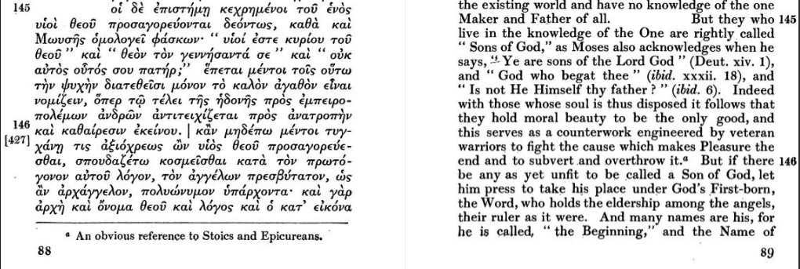
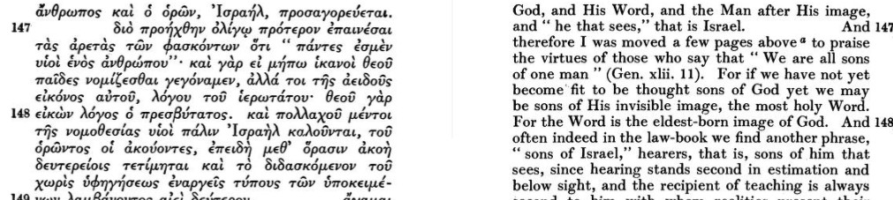
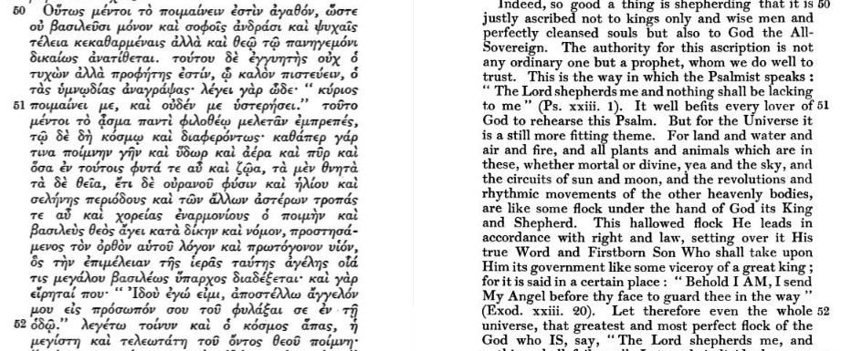

<!-- Raw answers, Colossians Logos round 5. Converted 4 November 2026 with pandoc from Patrick's
colossians-logos-questions-round-5.odt (answers written into the question sheet, 31 Oct - 3 Nov 2026).
Kept verbatim; the assessment is colossians-logos-answers-round-5-assessment.md. The Vulgate, KJV, Chrysostom
and Philo pastes are also filed in _texts/logos-exports/. -->

# Colossians: Questions for the Logos Research Assistant, Round 5

**Purpose:** these are the questions still open after the Book Overview v1.1 and the macro-synthesis (31 October 2026). They follow *logos-research-assistant-guidelines* in the Dig Deeper folder. The round has four aims:

-   **(a)** to give claim audit 4\'s twelve verdicts (C44--C58) the history-of-interpretation criterion they were issued without;
-   **(b)** to collect the same criterion for the first targets of claim audit 5, before it runs;
-   **(c)** to put the cruxes of the seven digs not yet taken to Logos (1:1--14, 1:21--23, 3:1--4, 3:5--11, 3:12--17, 4:2--6, 4:7--18) to your own commentaries;
-   **(d)** to close the items round 4 left open --- above all authorship, place and date, which the overview still carries without holders from your own commentaries.

**Date:** 31 October 2026

Use:

-   **Set the scope to your *****Colossians commentaries***** collection**, not \"All books\". Use *My Library* only where a question says so. In round 4 several answers drifted into Romans and Ephesians commentaries, and into works whose ownership is unknown.
-   **Ask one question per turn.** Where one question names four commentators and the answer comes back thin, ask it again for one commentator at a time.
-   **Paste the commentator\'s own section wherever you can.** In round 4 the pasted pages (Pao, Lange, the five Sabbath extracts) were what settled things. The summaries misfiled one commentator and invented one grammatical claim.
-   **Paste each answer back with its footnotes**, under the question as asked.

## How the List Is Arranged

The questions are grouped as in the earlier rounds, and within each group the first question matters most. Each question has three parts:

-   **Ask:** the wording to type.
-   **Why:** the open point it settles, and where the answer will be used.
-   **Watch for:** the check from the \"Reading the Answer\" section of the guidelines that is most likely to matter.

**What the answers can and cannot do.** None of the history-of-interpretation questions (groups 2 and 3) can move a claim-audit verdict by itself. They fill one row of the Hays criteria. An answer of the form \"no commentator links ...\" is a fact about one search, not proof that nobody has made the link.

**Your Colossians commentaries** (from your Logos bibliography, 28 October 2026):

-   **Technical:** Dunn (NIGTC); Pao (ZECNT); Witherington (*Socio-Rhetorical Commentary*); Brown (*Logos Research Commentaries*); Wright (TNTC); Bird (*New Covenant Commentary*); Osborne (*Verse by Verse*); Merkle et al. (*ESV Expository Commentary*); the *Cornerstone Biblical Commentary* (vol. 16); Evans and Bubeck (eds.), *Bible Knowledge Background Commentary*.
-   **Expository and older:** Lucas (BST); Anders (*Holman*); Barclay (*New Daily Study Bible*); Barry (*Not Your Average Bible Study*); Lange; Jamieson--Fausset--Brown; Barnes; Exell (*Biblical Illustrator*).
-   **Patristic:** Chrysostom, *Homilies on Colossians* (NPNF¹ 13).
-   **Biblical theology:** Lints, *Identity and Idolatry* (NSBT); Pao, *Thanksgiving* (NSBT).
-   **Reference works marked owned in round 4:** Beale, *The Temple and the Church\'s Mission*; EDNT; Vincent, *Word Studies*; Robertson, *Word Pictures* and *Grammar*; Deenick, *Righteous by Promise*.

**Not owned:** Arnold (WBC, 2025); Barth--Blanke; Sumney; Foster; MacDonald; Gupta; Moo; Lightfoot; Harris (commentary, EGGNT and *Prepositions*); Hendriksen; O\'Brien (WBC); BDAG; Beale (BECNT); Beale--Carson (*CNTUOT*); Comfort; Campbell. If the Assistant cites any of these, it is quoting them at second hand, and the answer should say through which owned work. Several of the digs\' \"For Logos\" notes name Moo, Harris, Lightfoot or BDAG. I have rewritten those questions for the commentators you own.

**Ownership unknown --- please tick or cross** (see *Checks to Make Outside the Assistant*, item 1):

Note: 'yes' and 'no' in place of tick and cross

Hoehner, H.W., Comfort, P.W. and Davids, P.H. (2008) *Cornerstone biblical commentary: Ephesians, Philippians, Colossians, 1&2 Thessalonians, Philemon.* Carol Stream, IL: Tyndale House Publishers -- yes

Metzger, *Textual Commentary* - no; Brannan, R. and Loken, I. (2014) *The Lexham Textual Notes on the Bible*. Bellingham, WA: Lexham Press (Lexham Bible Reference Series) - yes

LSJ -- yes: Liddell, H.G. *et al.* (1996) *A Greek-English lexicon*. Oxford: Clarendon Press.

the full TDNT -- no; only the abridged version, Kittel, G., Friedrich, G. and Bromiley, G.W. (1985) *Theological Dictionary of the New Testament, Abridged in One Volume*. Grand Rapids, MI: W.B. Eerdmans.

Jones, *OT Quotations and Allusions in the NT*; - yes: Jones, D.A. (2009) *Old Testament Quotations and Allusions in the New Testament*. Bellingham, WA: Logos Bible Software.

Beale--Gladd, *Hidden but Now Revealed* - no.

*DPL* - no

Left out on purpose:

-   everything closed in rounds 1--4, including the Sabbath, the \"hymn\", 1:19--20, 2:23 and the 3:24 mood;
-   counts, chains and \"only here\" claims, which the corpus settles;
-   the direction of dependence between Colossians and Ephesians, where round 1 found the literature divided and nothing in this round could change that.

## 1. Before the Series: Book-Level Questions

1.1 Authorship, place and date --- one commentator at a time

-   **Ask (once for each of Dunn, Wright, Pao, Witherington, Bird and Osborne):** In \[commentator\]\'s commentary on Colossians, who does he conclude wrote the letter, where was the writer when he wrote it, and when? Please quote his conclusion and give his main reason for each.

-   **Why:** asked in round 4 (2.2) and not returned. The overview\'s Presenting Situation still names its holders only from introductions and textbooks (round 3), marked \"not from the owned commentaries\". Dunn\'s view --- Timothy writing during Paul\'s lifetime, with his approval --- is still known only from round 2\'s summary.

-   Watch for:

    -   Stylistic or theological arguments presented as settled.
    -   Travel distances quoted without a source. Round 3\'s Caesarea \"350 miles\" and Rome \"900 miles\" looked wrong.
    -   A summary that reports the case a commentator *sets out* rather than the one he *adopts*. Round 3 misfiled Pao that way at 1:19.

In several of the commentaries, the discussion as to who, when and where take up many pages, which I've not included here.

Dunn[^1] sums up his studies by suggesting that if Paul wrote the letter, he had changed his style and developed his theology or had allowed someone else to interpret his thought and concerns. A third option is that a Pauline disciple wrote shortly after Paul's death, "seeking to be faithful to what he perceived would be the master's thought and concerns in the situation envisaged in the letter." He prefers to say that the letter "serves as a bridge between the undisputed Paulines and those members of the Pauline corpus that are generally considered post-Pauline".

Dunn is inclined toward the more traditional hypothesis that Colossians was written from Rome, pointing out that O'Brien (Colossians, Philemon, xliv-liv) agrees.

Wright sees "no need to reject the Pauline authorship of Colossians, nor to imagine that its authenticity must be defended by the hypothesis that Paul wrote it when he was older, more settled and mellow, than he had been when writing Romans or Galatians. Indeed, that view hardly fits 2:6--23, or for that matter Philippians 3:2ff. Colossians can be seen as simply one more example of that vivid and brilliant theological writing which characterizes, uniquely, everything Paul himself wrote."

He locates Paul in Ephesus, in the early 50s, while he is writing this letter.[^2]

Pao says that "\[a\]mong the various possibilities, to consider Paul as the author of Colossians is still the best hypothesis on which our reading can be constructed."

Pao accepts a Roman provenance, dating Colossians (and Philemon) to AD 60-62.[^3]

Witherington writes that "the voice is indeed Paul's and that the secretary is likely Timothy, but the decisive consideration is that Colossians is written in a style effective for reaching the audience in the Lycus valley, namely the style of Asiatic rhetoric. The style is deliberately chosen and probably reflects the skill of the composer, not merely his unreflected "natural" style."[^4]

He does not discuss the provenance of the letter.

Bird agrees with Dunn's 'bridge' idea. He would add "that this does not make Paul merely the authorizer rather than the author! He may have had varying degrees of input into his various letters ranging from writing them himself (Philemon), writing them with a coauthor (Colossians), dictating them (Romans), or authorizing their composition based on an earlier piece of correspondence (Ephesians). Given those qualifications, I have no hesitation in affirming Colossians as authentically Pauline and written in association with others such as Tychicus, Epaphras, Onesimus, Luke, and especially Timothy."

Bird finds that the "marginally less problematic of these options then is the Ephesian provenance.44 I surmise that the epistle to Philemon was written by Paul himself during an imprisonment in Ephesus (ca. 55--57 CE) and Philemon subsequently discharged Onesimus to Paul's service where he became thereafter part of Paul's entourage."[^5]

Osborne sees no need to consider that the letter was written by anyone else other than Paul. He comments, "As seen in 1 Corinthians 8:6 ("one God ... one Lord, Jesus Christ") and Romans 8:34, 38, Paul has a strong doctrine of Christ as one with the Father, and he has penned powerful christological hymns in Romans 1:3--4; 10:9--20; and Philippians 2:6--11. Certainly Paul reaches new heights with the claims of 1:15--20, but the Christology here builds on what he has said before. Moreover, his style is in keeping with the rest of the Prison Letters (Ephesians, Philippians, Philemon) and is not dissimilar to that of his other letters. None of us has a writing style that remains the same in all situations and contexts."

Osbourne sees a Roman imprisonment as "definitely the most likely" and written between AD 60 and AD 62.[^6]

1.2 The Lukan affinities

-   **Ask:** Do any of my Colossians commentaries note that Colossians 1:12--14 resembles Acts 26:18 (darkness and light; the authority of Satan; forgiveness; \"an inheritance among those who have been sanctified\") or Luke 1:68--79 (redemption, rescue, forgiveness, darkness)? Does any of them draw a conclusion from this about Luke\'s presence with Paul (4:14) or about the letter\'s setting?
-   **Why:** claim audit 4 rated Acts 26:18 *moderate--high* as shared conversion idiom: six of the rarer lemmas of 1:12--14 in one verse, against three for any other NT verse. The overview v1.0 now notes \"Lukan affinities, moderate\", and claim audit 5 is to test it. A commentator who saw it would meet the history criterion.
-   **Watch for:** any move from \"shared idiom\" to \"Luke wrote Colossians\" or \"Luke as amanuensis\". Record who says it and on what evidence; the overview keeps any authorship inference at *\[I\]*.

Only Dunn and Pao refer to Acts 26:18.

Dunn[^7] includes Acts 18:26 with Eph 5:8 and 1 Pet 2:9 as the closest parallels with Col 1:12. In a footnote for Col 1:14, he writes that "Aletti, *Épître aux Colossiens* 81--82, notes the close parallel here (1:12--14) with Acts 26:18 (darkness, light, authority, forgiveness of sins, lot, saints) and wonders whether it points to Lukan authorship for Colossians."

Dunn, J.D.G. (1996) The Epistles to the Colossians and to Philemon: a commentary on the Greek text. Grand Rapids, MI; Carlisle: William B. Eerdmans Publishing; Paternoster Press (New International Greek Testament Commentary).

Pao wonders if "Paul's use of this phrase here is constrained by the confessional nature of this statement rather than by the arguments that he will launch (cf. Acts 26:18)."[^8]

## 2. History of Interpretation for Claim Audit 4 (C44--C58)

Claim audit 4 left the history row of each Hays table marked \"pending Logos round 5\". These are its eleven questions, reworded for your owned commentaries. Ask 2.1--2.6 first.

2.1 The \"lot of the saints in light\" (1:12) --- angels or believers? (C46)

-   **Ask:** In Colossians 1:12, \"the inheritance of the saints in light\", do my commentators take \"the saints\" (τῶν ἁγίων) to be believers, angels, or both? Do any cite Wisdom 5:5 (\"his lot is among the holy ones\"), Psalm 16:5 (LXX 15:5, \"the portion of my inheritance\"), the Qumran texts (1QS 11:7--8; 1QH), or Acts 26:18?
-   **Why:** audit 4 rated \"the saints = believers\" *moderate--high* on the letter\'s own usage, Acts 26:18 *moderate--high*, and Wis 5:5 and Ps 15 LXX *low--moderate* each. The 1:1--14 dig (Open Question 2) asks the same.
-   **Watch for:** Qumran quoted without a text reference, or with the English only. Note who reads \"angels\", and whether they argue from Qumran or from Colossians.

Dunn, referring to Wis 5:5 and concludes that "the thought, then, may rather be of heaven as the shared inheritance of the (human) saints, since both at Qumran (1QS 11:7-8; 1QH 9:24-25; 11:10-12) and in the early Christian gatherings the joy of shared worship was understood as a foretaste of heaven. Certainly the closest parallels in the New Testament imply a strong measure of realized eschatology. Either way, there is a strong sense of an inestimable privilege, previously understood as Israel's alone, and of a hope for choice companionship and social identity that will extend beyond death and whose quality can be experienced already in this mortal life."[^9]

Dunn, J.D.G. (1996) The Epistles to the Colossians and to Philemon: a commentary on the Greek text. Grand Rapids, MI; Carlisle: William B. Eerdmans Publishing; Paternoster Press (New International Greek Testament Commentary), p. 77.

Wright applies the term to those who in Colosse have heard and received the gospel because God caused this to happen. He goes on to say, "expressing it thus enables Paul to evoke a whole world of imagery relating to Israel's exodus from Egypt and her entry into the promised land. The 'inheritance' alludes to the promised land of Canaan; 'the saints' is a regular term for the people of God, indicating that they are set apart from the world for his service... The addition of 'in light' differentiates between the new and the old inheritance (the glory of heaven, not the land of Canaan) and also sharpens the moral contrast with the kingdom of darkness (v. 13), where the young Christians had formerly dwelt."

He adds in a footnote (fn. 12) that "\[t\]his apparently natural understanding of 'saints' has been challenged by some recent writers who, on the basis of impressive parallels from Qumran, take it to refer to angels. This seems to me to conflict with Paul's regular theology: God's people inherit not angelic privileges---that is, according to many scholars, one of the ideas Colossians is written to counteract---but precisely human ones. These, in the light of the incarnation, are if anything actually greater, not less, than those of the angels." However, he does not cite any Scrolls.[^10]

Pao writes that "the motif of the "share" and the "inheritance," together with the dualism between "light" and "darkness" (v. 13), has prompted some to read this section in light of Qumran material (e.g., 1QS 11.7--8; 1QH 3.19--22). This would in turn affect the way one understands the reference behind "the saints" (τῶν ἁγίων) since in these Qumran references "the saints" are understood as "the angels." Against this reading, however, is the use of "saints" already in vv. 2 and 4, which clearly points to the believers. Even in the Qumran material the word does not refer to "the angels."

"More importantly, this verse should be read in light of the exodus traditions in the OT. First, the use of both "share" (μερίς) and "inheritance" (κλῆρος) points to the apportionment of the land of Canaan in the exodus/conquest tradition (Deut 32:9; Josh 19:9). The concept of "deliverance" and "transfer" in v. 13 also points to this past salvific act of God. Moreover, in evoking the exodus traditions in describing the eschatological act of God, Isaiah also uses the same ideas: light/glory, deliverance, inheritance, and holiness (Isa 63:15--19). Therefore, "the saints" here should likewise be understood within this tradition where it is applied to God's chosen people (e.g., Num 15:40; 16:3; Deut 14:2; cf. Isa 4:3).

"In the light" (ἐν τῷ φωτί) can modify the "saints," but it most likely modifies "the inheritance." This prepositional phrase, then, distinguishes this inheritance from the earthly inheritance promised to Israel of old. In light of its contrast with "the dominion of darkness" in v. 13, the NIV has rightly translated this phrase as "in the kingdom of light." For Paul, believers should rest secure in the promise of the inheritance in the kingdom of light. Moreover, in view of the polemical use of the imagery of light in Eph 5:6--14, where light is defined as "goodness, righteousness and truth" (Eph 5:9), it is also possible that Paul is here affirming the significance of "the word of truth" (Col 1:5) that the Colossians have received, and they should not be persuaded by the message preached by the false teachers."[^11]

Witherington, focussing on the "not yet" dimension to things -- the portion, lot, or inheritance -- alludes to the allocation of different portions of the Promised Land after the exodus.

"Paul says that receiving such a portion is in the future, and in the present it is God, not believers or teachers or ritual practices, that is making the Colossians fit to receive the portion. Whatever claims the false philosophy might make, whatever knowledge, wisdom, or experience might be on offer, these things cannot make the Colossians fit for the inheritance. Only God in Christ can do that. There was plenty of precedent for using this sort of language to speak of the eschatological hope of a share in the resurrection and the life to come (Dan. 12:13; Wis. 5:5; 1 Enoch 48:7). At Qumran "the lot of the saints" or their "everlasting portion" refers quite specifically to such eschatological blessings (1QH 11:10--12; 1QS 11:7--8)."[^12]

Bird: "Paul proceeds to call the Colossians to be full of thankfulness towards God and accompanied with joy. The reason for this joy is that the Father has qualified you to share in the inheritance of the saints in the light. The word hikanoō means to make sufficient, adequate, or qualified (see 2 Cor 3:6). Ironically, whereas the Father has qualified them, the Colossians are giving ear to those who want to "disqualify" them (see 2:18). This is similar to the language of "justification" insofar as God has bestowed a special status on the Colossian believers that is complete, comprehensive, and requires no supplementary addition achieved through tertiary rituals. What the Father has qualified them for is more interesting. Inheritance has an obvious background in the Old Testament, and the land was Israel's inheritance (e.g., Deut 26:1--2; Josh 11:23; Ps 105:11). However, in the New Testament inheritance (usually klēronomia) has a decidedly non-geographic meaning and is synonymous with salvation (Eph 1:14, 18), the future expression of the kingdom (Eph 5:5), eternal life (Heb 9:15; 11:8), heaven (1 Pet 1:4), and a heavenly reward (Col 3:24). In line with Col 3:24, this "inheritance" or "lot" (klēros) is probably to be identified with a transcendent reward associated with sharing in the saints in the light. This is an enigmatic phrase and some translations seek to remove the strangeness by adding "kingdom of light," which is not in the Greek text. The addition of "kingdom" is understandable given the reference to the "kingdom" of the Son in v. 14. If the saints are believers (see 1:4, 26) then the parallel in Ephesians is quite relevant and this refers to "his glorious inheritance among the saints" (Eph 1:18; cf. 5:5). Paul might be saying no more than that the Colossians have a part in the glorious inheritance of God's people in the heavenlies. But two things count in favor of an alternative proposal. First, saints or "holy ones" (hagioi) can also refer to angels (e.g., Zech 14:5; 1 En. 1:9; Pss. Sol. 17:43; 1QS 11:7--8; cf. 1 Thess 3:13; 2 Thess 1:10). Second, light (phōs) is an odd qualification for "saints" unless it refers to their transcendent and glorious destiny (e.g., Rev 21:24). However, light is also associated with angels (Acts 12:7; 2 Cor 11:14; 1QS 3:20) and light is something that comes from heaven during visions and visitations (Acts 9:3; 22:6; 26:13; Tob 5:10). Given the debate about the worship of/with angels in Col 2:18, Paul might be suggesting that believers have been qualified to inherit the rights and privileges normally given to angelic beings."[^13]

Osbourne notes that sharing in the inheritance of the saints "echoes Genesis 13:14--17 and the promise to Abraham that he and his progeny will inherit the promised land, a promise reiterated to Israel in Deuteronomy 32:9 and Joshua 19:9. This is part of the new-exodus motif in the New Testament, the notion that the church as the new Israel will fulfill God's promise to the people of Israel that they will one day "share" an "inheritance." This inheritance will be realized "in the kingdom of light" (Greek: "in the light"). The idea of a "promised land" as the earthly inheritance of God's people segues in the New Testament into a heavenly inheritance of "the kingdom of light"---eternal life in heaven. Believers no longer belong to the world but are already now "children of light" (John 12:36; 1 Thess 5:5)."[^14]

2.2 Colossians 1:12--14 as exodus language (C48)

-   **Ask:** Which of my commentators read Colossians 1:12--14 (\"rescued us from the domain of darkness ... transferred us ... redemption\") as exodus language? Which Old Testament texts do they name: Exodus 6:6--8, Exodus 14:30, Deuteronomy 9:26--29, Psalm 107 (LXX 106), or others?
-   **Why:** audit 4 rated the exodus pattern *moderate* and Exod 6 alone *low--moderate*. The overview\'s new row 16 rests on it. Deut 9:26--29 and Ps 106 LXX are queued for audit 5 (C61, C62).
-   **Watch for:** \"exodus\" asserted with no text named. Record that, but it does not meet the criterion.

Several commentators make this connection, and their comments are included in the text for Question 2.2 above.

2.3 The parable of the sower behind 1:6, 10 (C50)

-   **Ask:** Do any of my commentators connect \"bearing fruit and increasing\" (Colossians 1:6, 10) with the parable of the sower (Mark 4:8, 20; Luke 8:15), or with Genesis 1:22, 28 (\"be fruitful and multiply\")?
-   **Why:** audit 4 rated the sower *moderate as an early-Christian idiom* and *low--moderate as an allusion*; Genesis stays *uncertain*. The 1:1--14 dig asked about Dunn and Wright; Moo is not owned.
-   **Watch for:** Acts 6:7, 12:24 and 19:20 (\"the word of God grew\") offered instead. Record them; audit 4 named them as the rival.

Dunn notes a possible connection between Col 1:6 and Mk 4:8 on account of the ambiguity of αὐξάνω.[^15]

Wright notes an "oblique allusion" to Gen 1 in Col 1:10. "Just as the gospel is bearing fruit and growing, so God's people are themselves bearing fruit in every good work, and growing in the knowledge of God (the Greek verbs are the same as those in v. 6)... This (albeit indirect) reference to Genesis increases the awareness that what Paul is talking about is God's new creation. He is asking that the Colossians may understand themselves more and more to be God's new, true humanity, and that they may increasingly live in a manner appropriate to that vocation."[^16]

Pao says of Col 1:6 that "the metaphor of "bearing fruit and growing" may evoke Gen 1:28, and some have further suggested that this points to Paul's use of the Last Adam typology (e.g. Beale, Colossians, p. 844), although the linguistic parallels are not exact. Paul's usage here is consistent with other early Christian depictions of the spread of the gospel. Luke, for example, uses the metaphor of fruit-bearing in the parable of the sower in relation to the word (καρποφοροῦσιν, Luke 8:15), and he also uses the metaphor of growing in the depiction of the spread of the word (ηὔξανεν, Acts 6:7; 12:24; 19:20)."[^17]

Bird also picks up on the connection with Genesis 1:28. He comments, "Taken up here, the progeny of Jesus, the new Adam, are doing just that, and obedience to God's gospel-word is the means by which the old world is colonized by the new humanity of the new creation (see 1:10). (Beale (2007: 846) regards Paul's usage here as "typological" as "the continued failure to fulfill the Genesis commission pointed to an eschatological humanity that would finally be obedient to the Genesis command.") We can also see here a possible allusion to Isa 27:6, which says, "In days to come Jacob shall take root, Israel shall blossom and put forth shoots and fill the whole world with fruit" (ESV). The great redemption of Israel that Isaiah predicted with its replanting of Israel produces an abundance of fruit that grows into the entire world. So too does the redemption in Messiah Jesus and the calling of the church to be Israel-for-the-sake-of-the-world bring forth a fruit basket of blessings that covers the earth.[^18]

Osbourne notes that "the good news was "bearing fruit and growing," imagery echoing the creation account in Genesis 1:22, 28 ("Be fruitful and increase ... fill the earth"). Paul considered it the mission of the church to be part of a "new creation," a spiritual re-creation of humankind in the image of God (see also John 1:3--4). Fruit bearing is an important image for the expansion of the church, first to the unbelieving world and then to Christians as they "grow" in Christ (John 15:4, 8)."[^19]

2.4 The fear of the Lord and \"with all the heart\" at 3:22--24 (C45)

-   **Ask:** Do any of my commentators connect \"with sincerity of heart, fearing the Lord ... do your work heartily, as for the Lord\" (Colossians 3:22--23) with the Deuteronomic command to \"fear the LORD and serve him with all your heart\" (Deuteronomy 10:12; 1 Samuel 12:24)? Does anyone read \"the reward\" (ἀνταπόδοσις, 3:24) in the light of Psalm 19:11 (LXX 18:12)?
-   **Why:** audit 4 rated the formula *moderate, as Deuteronomic*, and Ps 18:12 *low*. Round 4 found no owned commentator linking the Old Testament fear of the LORD at 3:22 (C42).
-   **Watch for:** Ephesians 6:5--7 offered as the \"background\". It is the parallel, not the Old Testament claim.

Pao makes the Deuteronomic connection explicitly, noting that the phrase "fearing the Lord" evokes the "fear of the Lord" formula in the Old Testament, which applies specifically to God himself (citing Deuteronomy 6:2, 13, 24; 10:12, 20; Joshua 24:14; Psalms 33:8; 34:9; Proverbs 24:21; Jeremiah 5:24), and observes that the call to fear the Lord and serve him wholeheartedly recalls a similar call in 1 Samuel 12:24: "fear the LORD and serve him faithfully with all your heart." He emphasizes that in Colossians, this formula is applied to Jesus the Lord, reaffirming the exalted status of Christ in the letter.[^20]

Bird also recognizes the connection, noting that fear of the Lord is a mark of loving service to God (Deuteronomy 10:12--13) and a sign of God-centered wisdom.[^21]

However, none of the commentators appear to read the term against the specific language of Psalm 19:11. The focus remains on the promise of inheritance as compensation for slaves' lack of legal rights rather than on the psalmist's language about reward.

2.5 The virtues of 3:12 as God\'s character (C54)

-   **Ask:** Do any of my commentators connect the virtues of Colossians 3:12 (\"compassion, kindness, humility, gentleness and patience\") with God\'s self-description in Exodus 34:6 (\"compassionate and gracious, slow to anger\"), with Psalm 145:8--9 (LXX 144), or with God\'s kindness and patience in Romans 2:4?
-   **Why:** audit 4 rated the Exodus formula *low--moderate* as a field and *low* as an allusion. The overview\'s Christological Trajectory calls the virtues \"the family likeness\" (*moderate--high*) on the Pauline evidence. Both ratings want a holder.
-   **Watch for:** the theological point (\"we imitate God\") made without any text. Record it, but it is not the textual claim.

Osborne notes that "kindness" expresses a major Old Testament concept involving God's goodness and merciful actions, and that in the New Testament this gracious mercy draws people to repentance and salvation (Romans 2:4), with believers called to emulate these loving attributes of God and Jesus in their relations with one another.[^22]

Osborne also observes that "patience" refers to the longsuffering forbearance modeled by God and Christ (Romans 2:4), which believers are to show to others. (Merkle (in the Ephesians commentary) identifies patience as a characteristic of God mentioned repeatedly in the Bible, including Exodus 34:6, and notes that his patience leads us to repentance (Romans 2:4).[^23])

Gurtner connects compassion directly to God's self-description, noting that compassion is an attribute most commonly associated with God in his dealings with his people (Psalms 24:6; 50:1; 102:4; 144:9; Exodus 34:6; 2 Chronicles 30:9). He similarly identifies kindness as an attribute of God that he demonstrates in his acts in history (Psalms 25:7; 31:19; 65:11) and is used by the prophets to illustrate God's kindness in the face of his people's sin (Jeremiah 33:11).[^24]

None of the commentators explicitly connect these virtues to Psalm 145:8--9. The focus remains on Exodus 34:6 and Romans 2:4 as the primary Old Testament and New Testament parallels for understanding these virtues as divine attributes that believers are to embody.

2.6 \"Chosen, holy and beloved\" (3:12) and Israel\'s titles (C55)

-   **Ask:** Do any of my commentators connect \"as the chosen of God, holy and beloved\" (Colossians 3:12) with Deuteronomy 7:6--8 (a holy people, chosen because the LORD loved them), with Isaiah 44:1--2 (\"Jacob my servant, whom I have chosen ... Jeshurun\"), or with the Septuagint\'s use of \"the beloved\" (ὁ ἠγαπημένος) for Israel?
-   **Why:** audit 4 left C55 unchanged: the idea is *moderate*, and Deut 7 as the specific text is *low--moderate*. Macro-argument 7 (\"Israel\'s names for a Gentile church\") rests partly on it.
-   **Watch for:** 1 Peter 2:9 (Exod 19:6) offered as the parallel. Record it; it is another text.

Brown notes that Paul's description of believers as "God's chosen people, holy and dearly loved" recalls Israel's identity in the Old Testament, where Israel is referred to by exclusive phrases such as "a holy people" (Deuteronomy 7:6), the people whom God loves (Deuteronomy 7:8), and God's "treasured possession" (Deuteronomy 14:2).[^25]

Dunn emphasizes that Paul's application of "the classic covenant text" of Deuteronomy 7:6--7 to Gentiles is "striking," assuring Gentile believers they are "full participants in the people and heritage of Israel."

Dunn also identifies the concept of being "beloved" as a particular emphasis in Jewish self-understanding, citing Isaiah 44:2 alongside Deuteronomy 32:15, 33:26, Isaiah 5:1, 7, and Jeremiah 12:7, 31:3.[^26]

Pao notes that the description "elect of God," used for the Israelites in the Old Testament (Psalm 105:6, 43; Isaiah 43:20; 45:4; 65:9, 15), is particularly important since it is now applied to Gentile believers in Colossae.

Pao explicitly connects the phrase "holy and beloved" to Deuteronomy 7:6, quoting: "For you are a people holy to the LORD your God. The LORD your God has chosen you out of all the peoples on the face of the earth to be his people, his treasured possession."[^27]

Osborne similarly references Deuteronomy 26:18--19 and 7:6, 14:2 in explaining that those who are "the chosen people" are set apart by God for himself, fulfilling the imagery of Israel as "his treasured possession ... a people holy to the LORD your God."[^28]

None of the commentators explicitly connect these virtues to Psalm 145:8--9.

2.7 The Psalter\'s titles and 3:16 (C56)

-   **Ask:** How do my commentators take \"psalms, hymns and spiritual songs\" (Colossians 3:16)? Do any connect the three words with the headings of the Greek Psalms (ψαλμός, ὕμνος, ᾠδή), and do any discuss the argument that the verse means the Psalter only?
-   **Why:** audit 4 rated the observation about the titles *moderate* and discarded \"Psalms only\". A commentator\'s view of the exclusive-psalmody reading will help the preacher in some congregations.
-   **Watch for:** a confessional conclusion about worship presented as exegesis of the verse, either way.

Brown identifies the central interpretive challenge: determining whether the terms denote three distinct types of songs or refer to the same thing, complicated further by whether the adjective "spiritual" modifies all three "song" nouns, which would make distinguishing between types difficult. He documents that "psalms" denotes both scriptural psalms and songs offered in congregational worship; "hymns" refers to songs of praise to God performed publicly as cultic congregational songs; and "songs" (ōdē) describes songs of praise or thanksgiving directed to God. Notably, Brown observes that in the Psalms of Solomon, ōdē and psalmos are used almost interchangeably to describe a single kind of song.[^29]

Merkle takes a more unified approach, arguing that the three terms "psalms," "hymns," and "spiritual songs" are "intended to cover all the singing that went on in worship rather than to differentiate between them."[^30]

Exell notes that "psalm" in Colossians 3:16 and Ephesians 5:19 "in all probability" refers to the inspired Psalms of the Hebrew canon, specifically those of David, Asaph, and other biblical psalmists.

Concerning the argument that the verse means the Psalter only, none of your commentators entertain this interpretation. Rather, Exell emphasizes that the Church claims freedom to bring forth new compositions alongside the ancient psalms, since "a new salvation demanding a new song."[^31]

Regarding connections to Greek Psalm headings, I made the following notes in my research into the the terminology of the Septuagint's psalm superscriptions (ψαλμός, ὕμνος, ᾠδή) and Colossians 3:16 // Eph 5:19.

Two psalms in the LXX have all three words in their superscription:

> Psalm 67:title \[Ps 66:1 LXX\]

> Εἰς τὸ τέλος, ἐν ὕμνοις, ψαλμὸς ᾠδῆς.

> For the preeminent one, among hymns, a psalm of a song

> Psalm 76:title \[Psalm 75:1 LXX\]

> Εἰς τὸ τέλος, ἐν ὕμνοις, ψαλμὸς τῷ Ασαφ, ᾠδὴ πρὸς τὸν Ἀσσύριον.

> For the preeminent one, among hymns, a psalm of Asaph, a song for the Assyrians

> (Logos search: lemma.g:ψαλμός AND lemma.g:ὕμνος AND lemma.g:ᾠδή)

Hamilton[^32] comments on Psalm 67:

Psalm 67 captures God's purpose for the world when he created it and placed Adam and Eve in the garden. After their expulsion from Eden, God set about accomplishing the same purpose when he redeemed Israel from Egypt and put them in the land of promise. He meant to cause his glory to cover the dry lands as the waters cover the sea, as those who reflected his character exercised dominion over all he had made.

God means to bless the nations with the knowledge of his character and salvation that they might be glad in him, that they might praise him, that they might dwell in his presence and enjoy his blessing on the totality of their lives. He is pursuing this purpose now through the church, and when Jesus returns that purpose will be realised. The light of his presence will shine everywhere, replacing the sun as the source of radiance in all creation, and all will be glad in him, praise him, and enjoy his all-saturating goodness.

On Psalm 76 he writes:

The response to the radiant warrior come for judgment in Ps 76:4-6 recalls the warning to the kings to learn wisdom in Ps 2:10--12. Here all who find themselves surrounding Yahweh are urged to make and keep vows to him, to bring tribute to the fearsome one (76:11). Psalm 76:12 then asserts that God has the power to cut off the spirit of princes---nobility, high standing, royal descent avails nothing before the holy one of Israel. And this makes him, as the second half of the line puts it, "fearsome to the kings of the earth." God can do to every king on earth what he did to Pharaoh---put to death his firstborn son.

Mark Futato[^33] comments:

Through Psalm 67 God encourages his people to pursue the experience of his blessings in this life \... \[and\] to seek these blessings so that others might see the truly abundant life that \[his people\] have and desire that kind of life for themselves. God cannot use \[them\] to create in others a desire to have what \[they\] do not have.

Ultimately, we want to be blessed and be a blessing that we might experience great joy in God and give great glory to him. This is the heart of Psalm 67 and the heart of the true believer, for this is the heart of God. We see God's heart in his sending of the Lord Jesus Christ so that Jews and Gentiles might be blessed through faith in him (Gal 3:8--9).

Psalm 76 begins with God being well-known among his people and ends with him being well-known among the nations. The path to this spreading fame encompasses opposition to this fame by human forces. Not only will such opposition never stop the spread of God's fame, such opposition ultimately ends up facilitating that spread.

From this we learn that everything we experience in life produces a benefit. That benefit is not always evident in the middle of the battle, but by faith we know that God is at work in it all for our good and his glory (Rom 8:28). At the moment of the crucifixion of the Lord Jesus Christ, who could have imagined the cosmic good that was being accomplished and the eternal glory that God was gaining? What was true of Christ's life and death is also true of ours. With hindsight we will see the good and the glory of the past. So with the foresight of faith, we live out the present and fearlessly face the future.

Beale:

λαλοῦντες ἑαυτοῖς **ψαλμοῖς** καὶ **ὕμνοις** καὶ **ᾠδαῖς** πνευματικαῖς (Eph 5:19a)

διδάσκοντες καὶ νουθετοῦντες ἑαυτοὺς **ψαλμοῖς**, **ὕμνοις**, **ᾠδαῖς** πνευματικαῖς Col 3:16.

The close syntactical combination of "psalm" (ψαλμός), "hymn" (ὕμνος), and "song" (ᾠδή) within the space of one verse occurs only two times in the Psalter: in the LXX versions of Pss. 67:title and 76:title.

Ps. 67:title: ἐν **ὕμνοις** **ψαλμὸς** **ᾠδῆς**

Ps.76:title: ἐν **ὕμνοις**, **ψαλμὸς** τῷ Ασαφ, **ᾠδὴ** πρὸς τὸν Ἀσσύριον

The three words are placed directly next to one another in both psalms (Ps. 76:title has "pertaining to Asaph" intervening between ψαλμός and ᾠδή in LXX), without a conjunctive καί and without an article before any of the words, as in Col. 3:16 (Eph 5:19 has the conjunctive καί).

It is possible to punctuate the LXX version of Ps. 67:title in the following way: "Among hymns. A Psalm. Of an Ode" (so NETS). However, NETS gives a marginal reading closer in line with that of Colossians: "a psalm (instrumental music) *accompanied by a song of praise *(vocal music)" (emphasis original; "praise" is a rendering of ᾠδή). The most formally equivalent reading would be "among hymns, a psalm of a song." The three words in Colossians and Ephesians may be plural since the allusion is to both psalms as representing the whole corpus of psalms.

Strikingly, both psalms also mention eschatological salvation of Gentiles (a theme not far away in Colossians; e.g., Col 3:11, and Ephesians, e.g., Eph 2:13ff). Psalm 67 highlights this in six of its eight verses (e.g., v. 2, "that Your way may known on the earth, Your salvation among all nations"), and Ps. 76 mentions it in verse 9 ("to save all the humble of the earth"). (The added phrase, "for the Assyrian" is appended as a variant reading at the end of the superscription, adding to the Gentile flavour of the psalm. It may even indicate that the psalm was also intended for a Gentile audience \[cf. Ps 80:title in LXX\].) Consequently, the threefold wording of the two psalms appears to be reflected in Col. 3:16 and Eph. 5:19 not only because the combination occurs only in the OT in those two psalms, but also partly because of the connection to Gentile salvation, a theme not far away in either Colossians or Ephesians. In this respect, saved Gentiles are certainly included among the ones who are to follow the instruction of Col 3:16/Eph 5:9.

It is likely not coincidental that the threefold lexical combination referring to psalms in the superscription of Ps. 67:title is directly followed by an allusion to the Aaronic blessing from the tabernacle in Num. 6:24--26, "The LORD bless you, and ... the LORD make his face shine on you and be gracious to you"; thus Ps. 67:1 has "God gracious to us and bless us, cause his face shine with us." Similarly, after the same superscription containing the threefold psalm reference in Ps. 76:title, verse 2 also refers to the temple: "His \[God's\] shelter is in Salem, His dwelling place also is in Zion."

"Shelter" (τόπος) is typically a reference to the temple in the LXX and the NT, and over half of the LXX uses of "dwelling place" (κατοικητήριον) refer to God's temple. One of only two NT uses of the latter word refers to "dwelling \[place\] of God in the Spirit" (Eph. 2:22), of which believers are a part and of which Christ is the "cornerstone" (2:19-22). Notice also that Ps. 76:2 mentions God's cultic "place" being "in Salem" and "his dwelling place" being "in Zion," which is similar to the parallelism of Col. 3:15, "Let the peace of Christ rule in your hearts"; and 3:16, "Let the word of Christ richly dwell within you."

Thus both superscriptions introduce psalms that begin with reference to God being in his temple. In Psalm 67 this is implied through the allusion to Numbers 6:25-26. Accordingly, when Col. 3:16 (cf. Eph 5:20) concludes its reference to "psalms \[and\] hymns \[and\] spiritual songs" with "singing with thankfulness in your hearts to God," the reference may be to worship directed to God in his heavenly temple. This would certainly fit with the earlier references to the temple in \[both\] epistles (e.g., Col 1:9--10; 1:19; 2:9--10, 18; Eph 2:20-22).

All of this points to the three terms in Col. 3:16 (and Eph 5:19) referring to actual OT psalms or songs/hymns composed on the basis of such psalms, which would now be related to the new revelation of Christ. Since all three words refer to OT psalms, there is no need to try to find distinct meaning among them. Indeed, "letting the word of Christ dwell within you" takes place by means of or, better, in the manner of "teaching and admonishing" in OT psalms (Col 3:16). The OT psalms are now viewed to be the very word of Christ! The psalms should now be understood fully through the lens of Christ.

The revelatory nature of these "songs" is expressed with the adjective "spiritual" (πνευματικός, *pneumatikos*). In Col 1:9, in the phrase "all spiritual wisdom and understanding" (cf. Eph 1:17), the adjective "spiritual" (πνευματικός) refers to God's Spirit, who imparts the "wisdom" and "understanding". The same is probably the case here with "spiritual songs" (and by implication "psalms" and "hymns"). God's or Christ's Spirit inspires such OT "songs," which are now sung by the new-covenant community.

The verses place squarely on the shoulders of each Christian the responsibility to "teach and admonish one another" and to "speak to one another" through psalm-based material and to sing psalm-like hymns to God. There is a place for each believer in teaching and admonishing other believers through Christ's word. By so doing, the Colossian and Ephesian believers will prevent one another from being "lured into the false teaching that may be captivating some of the group," especially a teaching focusing on mystical experiences instead of Christ-centred instruction.[^34]

2.8 Daniel 2:8 behind \"buying up the time\" (4:5) (C57)

-   **Ask:** Do any of my commentators connect \"making the most of the opportunity\" (τὸν καιρὸν ἐξαγοραζόμενοι, Colossians 4:5; Ephesians 5:16) with Daniel 2:8, where the king tells the wise men that they are \"buying time\"? How do they take the verb --- \"buying up\" the opportunity, or \"redeeming\" it from evil?
-   **Why:** audit 4 rated the Daniel contact *low--moderate*, and moderate as the only Greek-Bible precedent for the phrase. The 4:2--6 dig (Open Question 1) leans *moderate--high* to \"buying up\". BDAG is not owned, so the lexical sense must come from the commentators or EDNT.
-   **Watch for:** the meaning in Daniel (\"stalling\") carried over into Colossians without comment. The sense is reversed.

Osborne notes that Paul could be alluding to the Greek (Septuagint) translation of Daniel 2:8, which describes King Nebuchadnezzar accusing his court magicians of "trying to gain (buy) time" to interpret his dream. The verb Paul uses (exagorazomenoi, based on the verb meaning "to buy up") is part of the redemption language in Galatians 3:13 ("Christ redeemed us") and 4:4--5 ("God sent his Son ... to redeem"), where Paul's point is that Christ has "purchased" or "redeemed" humanity from the curse of the law. In this secular age ("because the days are evil," Eph 5:16), Paul urges believers to use their time redemptively---to take advantage of every opportunity to magnify Christ and bring glory to his name.[^35]

Pao explains that the compound verb can be literally rendered as "buying out," which is used elsewhere in the sense of redemption (Gal 3:13; 4:5), and the phrase has thus been rendered as "redeeming the time" (KJV, ASV, NKJV). Although a theological sense of redemption does not seem to be present here, the idea of buying out is supported by the additional clause in the Ephesian parallel ("because the days are evil," Eph 5:16)---that is, since "the prevailing evil of the times makes the opportunities for good more precious." Pao also notes the presence of a parallel in Daniel, where a similar phrase is used: "I am certain that you are trying to gain time" (Dan 2:8). In that context, the Babylonian king has accused his astrologers of attempting to buy time in their delay to provide the proper interpretation for his dreams.[^36]

Wright observes that the verb literally means "buying up" or "buying out": it does not necessarily have the sense (as Eph. 5:16 appears to do) that the time is somehow evil and must be redeemed, but simply that every opportunity is to be snapped up like a bargain.[^37]

Dunn notes that the verb would normally mean "buy" or "buy back," and therefore "redeem" (Gal. 3:13; 4:5), with the likely meaning being "gain or reclaim time" which would otherwise be lost or slip away. Dunn cites Dan. 2:8 LXX: "you are trying to gain time."[^38]

2.9 Job 31:13--15 behind 4:1 (C44)

-   **Ask:** Do any of my commentators cite Job 31:13--15 (\"Did not he who made me in the womb make him?\") at Colossians 4:1, \"you too have a Master in heaven\"? If so, do they cite the Hebrew or the Greek?
-   **Why:** audit 4 rated it *low*: the \"one Maker\" line is Hebrew-only, and the Greek of Job does not carry it.
-   **Watch for:** Ephesians 6:9 or Proverbs 22:2 offered instead (C64, record only).

None make reference to Job 31:13-15

**2.10 Deuteronomy 29:29 behind 3:3--4 (C52)** --- *low priority*

-   **Ask:** Does any of my commentators cite Deuteronomy 29:29 (\"the secret things belong to the LORD ... the things revealed belong to us\") at Colossians 3:3--4 or 1:26?
-   **Why:** audit 4 rated it *low* (2 Macc 12:41 breaks the \"only\").

Dunn cites Deuteronomy 29:29 at Colossians 3:3--4. He notes that the antithesis of "hidden" versus "open" (κρυπτός, φανερός) is also the more natural contrast, citing Deuteronomy 29:29 alongside Mark 4:22/Luke 8:17, Romans 2:28--29, and 1 Corinthians 14:25. This connection illustrates how Paul's language of present hiddenness and future visibility draws on established biblical vocabulary for the contrast between what remains concealed and what will be revealed.

The other commentators in the search results do not explicitly cite Deuteronomy 29:29 at these passages. Pao discusses the hiddenness of believers' lives with Christ and its connection to the mystery revealed in 1:26, but does not reference the Deuteronomy text. Brown's treatment of Colossians 1:26--27 focuses on various interpretations of the mystery's revelation to the Gentiles without invoking Deuteronomy 29:29. Wilson similarly addresses the mystery as "that which was once hidden but is now revealed" without citing the Deuteronomic parallel.[^39]

**2.11 Gethsemane and Mark behind 4:2--6 (C58)** --- *low priority*

-   **Ask:** Do any of my commentators see Jesus\' \"watch and pray\" (Mark 14:38) behind \"keeping alert in it\" (Colossians 4:2), or Mark 4:11 and 9:50 behind 4:3--6?
-   **Why:** audit 4 discarded the \"Jesus-tradition cluster\": a quarter of random Pauline paragraphs show as many pairings. A holder would not revive it, but would show where the idea comes from.

Dunn: "the link with prayer may echo the scene in the garden of Gethsemane from the passion narrative, which would no doubt be familiar in all the early Christian churches (Mark 14:38/Matt. 26:41), since there is no other obvious reason why the metaphor should be preserved here (Moule, Colossians and Philemon 132; Houlden 216; Caird 210)."[^40]

Pao:

The verb γρηγορέω appears elsewhere with the call to pray in a critical situations ("watch \[be alert\] and pray \[γρηγορεῖτε καὶ προσεύχεσθε\] so that you will not fall into temptation" \[Mark 14:38; cf. Matt 26:41\]), and it is often used in eschatological contexts where the end of the ages is in view (e.g., 1 Thess 5:6; Rev 3:3; 16:15; cf. 1 Cor 16:13).[^41]

While this note clearly specifies the content of the "prayer" to which believers are to be devoted, the parallel between this clause and the previous one is important:[^42] to pray for the further proclamation of the mystery of Christ is the manifestation of one's alertness in prayer in this eschatological era.

A parallel can be found in the Gethsemane scene, where Jesus urges his followers to "watch and pray so that you will not fall into temptation" (Mark 14:38; cf. Matt 26:41).[^43]

## 3. For Claim Audit 5 --- Before It Runs

3.1 Psalm 107 (LXX 106) behind 1:13--14 (C61)

-   **Ask:** Do any of my commentators connect \"rescued us from the domain of darkness\" (Colossians 1:13) with Psalm 107:10--16 (LXX 106), the redeemed who \"sat in darkness\" and were \"brought out of darkness\"? Or with Isaiah 42:7, 16?
-   **Why:** C61 is queued at *low--moderate*. It was found by both auditors independently, and the scan cannot see it.
-   **Watch for:** Isaiah 9:2 or Luke 1:79 offered instead. Record them, and note that Luke 1:79 is C63.

Pao explicitly connects the language of "rescued us from the domain of darkness" with Isaiah 42:7 and 16. He notes that the combination of redemption and darkness appears in Isaiah, where God's eschatological act of salvation is portrayed as a new exodus (Isaiah 41:14; 42:7, 16; 43:1, 14; 44:22--23).

Pao also situates this language within a broader exodus framework. The verb "delivered" together with the term "redemption" in verse 14 points to God's deliverance of Israel in the Exodus narrative: "I am the Lord. I will bring you out from the control of the Egyptians, and I will deliver you from slavery, and I will redeem you by an outstretched arm and great judgment" (Exodus 6:6 LXX). This tradition has also been evoked in the prophets in pointing to eschatological salvation: "I will rescue them from the hand of Hades, and I will redeem them from death" (Hosea 13:14 LXX; cf. Micah 4:10).[^44]

Osborne similarly emphasizes the exodus connection. He notes that the language of "delivered ... transferred" alludes to the Israelites in the exodus, who were delivered from the Egyptians, "redeemed" from slavery, and "brought into" the promised land and freedom (Exodus 6:6; 14:30; Deuteronomy 7:8).[^45]

No commentators explicitly cite Psalm 107:10--16 (LXX 106) in connection with Colossians 1:13, despite the psalm's thematic resonance with being "brought out of darkness."

3.2 Deuteronomy 9:26--29 behind 1:12--14 (C62)

-   **Ask:** Do any of my commentators connect \"the share of the lot\" and \"redemption\" in Colossians 1:12--14 with Deuteronomy 9:26--29 (\"your people and your inheritance, whom you redeemed\") or Deuteronomy 32:9 (\"the LORD\'s portion is his people; Jacob is the lot of his inheritance\")?
-   **Why:** C62 is queued at *moderate*. Round 4 found Wall (ownership unknown) citing Deut 32:9 at 1:12.
-   **Watch for:** the Joshua allotment field (Josh 18--19). Audit 3 rated it *low* (C43); record it, but it is not this claim.

Osborne notes that the purpose of Jesus' redemptive work---that believers "share in the inheritance of the saints"---echoes the promise to Abraham and is reiterated to Israel in Deuteronomy 32:9 and Joshua 19:9.[^46]

Brown observes that both "inheritance" (klēros) and "share" (meris) appear in Old Testament descriptions of the promised land, including Deuteronomy 32:9. He suggests that the significance of this metaphor in Paul's opening prayer is the function of land and salvation as a gift from God.[^47]

Additionally, Merkle notes that redemption in the Old Testament describes the deliverance of God's people from slavery in Egypt, citing Deuteronomy 7:8; 9:26; 13:5; and 1 Chronicles 17:21.[^48] This connection to Deuteronomy 9:26 (which contains the phrase "your people and your inheritance, whom you redeemed") establishes the theological framework Paul employs in Colossians 1:12--14.

No commentators explicitly cite Deuteronomy 9:26--29 by its full reference, though the redemption language and the concept of God's people as his inheritance are clearly drawn from that tradition. The commentators emphasize the exodus motif and the transfer of believers into God's kingdom as fulfilling the Old Testament promise of inheritance, but they do not quote Deuteronomy 9:26 directly at this passage.

3.3 Luke 1:68--79 behind 1:13--14 (C63)

-   **Ask:** Do any of my commentators compare Colossians 1:13--14 with Zechariah\'s song in Luke 1:68--79 (\"he has visited and redeemed his people ... rescued from the hand of our enemies ... the forgiveness of their sins ... those who sit in darkness\")?
-   **Why:** C63 is queued at *moderate*, as a shared idiom. With Acts 26:18 (question 1.2) it is the case for the Lukan affinities.
-   **Watch for:** a liturgical or hymnic theory (both passages as early hymns) offered as the explanation. Record it as *\[S\]*.

None.

3.4 The personal frame: 1:24--2:5 and 4:2--18

-   **Ask:** Do any of my commentators note that Paul\'s account of his own labour for the Colossians (1:24--2:5) is matched or answered by the closing section (4:2--18) --- for instance, that Epaphras \"labouring earnestly for you in his prayers, that you may stand perfect and fully assured\" (4:12) repeats the words of 1:28--2:2?
-   **Why:** the overview\'s Arc Map proposes this frame at *moderate* (claim audit 1), and macro-argument 9 carries it. It is the first target for audit 5. Romans has the same frame (15:14--33 with 1:8--17); Philippians, 2 Corinthians and 2 Timothy do not.
-   **Watch for:** a general \"the letter ends as it began\" with no verse named. Record it, but it does not meet the criterion.

Pao explicitly notes this structural correspondence. He observes that Epaphras's appearance in both the opening and closing of the letter confirms his significance in both Paul's ministry and among the Colossian believers. More importantly, Pao identifies that Paul uses the same verb to describe Epaphras's "striving" in prayers as he used for his own "striving" on behalf of the Colossian believers, establishing a direct verbal echo between the two sections.

Pao further demonstrates the thematic matching: the maturity of the Colossian believers highlighted as the focus of Paul's gospel ministry in 1:28 ("we may present everyone mature in Christ") is likewise the content of Epaphras's prayer in 4:12, and the reference to "the will of God" in 4:12 points back to Paul's prayer in 1:9 on behalf of the Colossian believers.

Pao frames this as Paul symbolizing the continuation of his own labor of love through Epaphras, as the believers are called to continue Paul's mission in proclaiming the gospel in their own contexts. This structural design reinforces the letter's theological argument: just as Paul labors and prays for their maturity and assurance in God's will, so Epaphras extends that same apostolic concern, demonstrating that the Colossian community is embedded within a network of faithful workers united in a common purpose.[^49]

3.5 The dwelling chain: 1:19, 2:9 and 3:16

-   **Ask:** Do any of my commentators connect \"let the word of Christ dwell (ἐνοικείτω) in you richly\" (Colossians 3:16) with \"all the fullness was pleased to dwell (κατοικῆσαι)\" (1:19) and \"in Him all the fullness of Deity dwells (κατοικεῖ)\" (2:9)? Does anyone draw out a temple theme across the three?
-   **Why:** the macro-synthesis listed the dwelling chain as a candidate thread, near the three-passage gate but *not yet macro*, because 2:9 is mediated by 1:19. Beale\'s *Temple*, which you own, is the likeliest source.
-   **Watch for:** the temple theme argued from 1:19 alone (Ps 68 LXX), with 3:16 not discussed.

Pao identifies "fullness" and "to dwell" as key terms that reappear throughout Colossians, appearing in 1:19, 2:9, and 3:16,[^50] establishing a verbal continuity across the letter.

More significantly, Garland reads [Colossians 1:19](https://ref.ly/Col1.19) and 2:9 as both asserting that the full embodiment of God dwelt in Christ, considering "fullness" as a circumlocution for God since "God pleases to dwell fully and permanently only in Christ." He traces the background to Old Testament passages that speak of God choosing a place for His name to dwell, claiming that Christ "supplants" the temple and "represents God in person."[^51]

Moo similarly grounds the language of "dwelling" in the image of God dwelling in the temple[\[2\]](https://ref.ly/logosres/LLS:LBG72COL?pos=res%2FLLS%3ALBG72COL%2F2019-09-04T23%3A00%3A29Z%2F69415), which provides the conceptual framework for understanding how the same verb appears across all three passages. The progression moves from the cosmic claim that divine fullness dwells in Christ (1:19), to the affirmation that this fullness continues to dwell in Him bodily (2:9), to the practical exhortation that believers allow Christ's word to dwell richly within them (3:16). This trajectory suggests that believers become living temples indwelt by Christ's presence through His word---a development of the Old Testament temple theology applied to the Christian community.[^52]

3.6 The \"you\" → \"us\" shift at 1:12--13 and 2:13

-   **Ask:** Do any of my commentators comment on the change from \"you\" to \"us\" in Colossians 1:12--13 (\"qualified you ... rescued us\") and in 2:13 (\"he made you alive ... having forgiven us\")? Do they explain it as Paul including himself with the Gentile readers, as liturgical or confessional language, or as a scribal problem?
-   **Why:** the 1:1--14 dig rates the shift *moderate--high* as deliberate (Echo row 31), and it is the third target for audit 5. At both places the manuscripts level the pronoun one way or the other (NA28 apparatus).
-   **Watch for:** the 1:12 variant (ὑμᾶς / ἡμᾶς) treated as settling the question. The shift at 1:13 stands in every witness.

Osborne notes an interesting interplay between "we" in verses 9 and 13 and "you" in verses 10--12, explaining that the "you" refers to the inclusion of the Gentiles in Colossae among God's people, while the "we" represents the combined church, consisting of both Jews and Gentiles, emphasizing that all of humanity is the focus of Christ's redemptive act.[^53]

Wilson provides a similar interpretation for the shift in 1:13. He observes that the first-person pronoun "us" marks a change from the second-person "you" used in preceding verses, and it may include the Colossian Christians, Paul and Timothy, and the wider Christian community---all of whom required and have experienced God's gracious rescue. If Paul's language recalls the experience of the people of Israel, it is striking that now the deliverance is experienced by a community that includes both Jews and Gentiles.

For Colossians 2:13, Wilson notes that Paul shifts to first-person plural pronouns as he describes the experience of every believer, suggesting that the transition from "you" to "us" reflects Paul's intention to universalize the application---moving from addressing the specific Gentile readers to encompassing all believers, both Jewish and Gentile.[^54] Neither commentator attributes the shift to scribal error or identifies it as purely liturgical or confessional language. Rather, both interpret it theologically as Paul's way of emphasizing the inclusive scope of salvation across ethnic boundaries.

## 4. The Newer Digs: Cruxes for Your Own Commentaries

These come from the Open Questions of the seven digs not yet taken to Logos. Each commentator is named because he is owned.

4.1 Colossians 1:11--12 --- where does \"with joy\" go?

-   **Ask:** In Colossians 1:11--12, do Dunn, Pao, Wright and Bird take \"with joy\" (μετὰ χαρᾶς) with what precedes (\"endurance and patience with joy\") or with what follows (\"with joy giving thanks to the Father\")? On what grounds?
-   **Why:** this is the 1:1--14 dig\'s Open Question 1, and it is \"genuinely open\". NA28\'s full stop puts \"with joy\" with the thanksgiving, and the ESV and NASB95 divide.
-   **Watch for:** an answer settled by an English version\'s punctuation alone.

The search results reveal a clear division among these scholars on how to construe "with joy" in Colossians 1:11--12.

Pao notes that some versions attach the phrase to "endurance and patience," while most connect it to the participial phrase that follows: "giving joyful thanks to the Father." Pao himself favors the latter reading, arguing that since the three preceding participial phrases contain prepositional phrases, this fourth one should also be understood as part of its participial phrase. Additionally, Pao observes that while joy often appears in contexts requiring endurance and patience, Paul elsewhere prays "with joy" when giving thanks to God (Phil 1:4). He further argues that Paul considers giving thanks "with joy" as paralleling "being strengthened with all power," and just as "bearing fruit" and "growing" form a closely related pair, "being strengthened" is closely related to "giving thanks."[^55]

The search results from Dunn, Wright, and Bird do not directly address this syntactical question.

However, Dunn notes that thanksgiving should be the basic attitude of Colossian Christians, with the double emphasis within three verses (1:12 and 3:17) underlining this point.[^56]

4.2 Colossians 1:7 --- \"on your behalf\" or \"on our behalf\"?

-   **Ask:** In Colossians 1:7, which reading do Dunn and Pao adopt --- ὑπὲρ ὑμῶν (\"on your behalf\") or ὑπὲρ ἡμῶν (\"on our behalf\") --- and why? Does any owned work explain why the NA28 text reads ὑμῶν against 𝔓⁴⁶ א\* A B D\* F G?
-   **Why:** this is the 1:1--14 dig\'s Open Question 3, rated *uncertain*. The ESV follows the NA28, the NASB95 the older witnesses. It decides whether Epaphras is introduced as Paul\'s deputy or as the church\'s own minister.
-   **Watch for:** \"the better manuscripts\" claimed for ὑμῶν. The external evidence printed in the apparatus favours ἡμῶν.

The search results do not directly address the textual-critical question you've posed regarding which reading Dunn and Pao adopt in Colossians 1:7, nor do they explain the NA28 decision to prefer ὑμῶν despite the early manuscript evidence.

However, A.T. Robertson's commentary identifies "on our behalf" (ὑπὲρ ἡμῶν) as "clearly correct" based on witnesses including Aleph, A, B, and D, rather than "on your behalf" (ὑπὲρ ὑμῶν). Robertson explains that "in a true sense Epaphras was Paul's messenger to Colossae", which supports reading ἡμῶν as the more coherent choice semantically.[^57]

Notably, neither Dunn nor Pao directly discusses this variant in the excerpts provided. Pao mentions Epaphras's introduction in 1:7--8 and confirms his significance in both Paul's ministry and among the Colossian believers[^58], but this doesn't address the textual question. Similarly, Dunn notes that Epaphras "had first taught them the gospel",[^59] yet neither scholar's comments on this verse directly engage the ὑμῶν/ἡμῶν decision.

4.3 Colossians 1:22 --- active or passive, and who is \"before him\"?

-   **Ask:** In Colossians 1:22, do Dunn and Pao read the active ἀποκατήλλαξεν (\"he reconciled\") or the passive ἀποκατηλλάγητε (\"you were reconciled\", 𝔓⁴⁶ B)? Does either treat the passive as original? And do Dunn, Pao, Wright and Bird take the subject, and \"before him\" (κατενώπιον αὐτοῦ), to be God or Christ?
-   **Why:** these are the 1:21--23 dig\'s Open Questions 1--2. The dig rates God as subject *moderate--high*. Round 4 found that Dunn\'s \"reverts to ... through Christ to God\" is his reading of an unexpressed subject.
-   **Watch for:** the SBLGNT\'s passive text treated as a mistake without argument.

Regarding the textual variant, the search results do not directly address whether Dunn and Pao adopt the active ἀποκατήλλαξεν or the passive ἀποκατηλλάγητε, nor do they discuss whether either scholar treats the passive as original. The documents consistently cite the active voice without textual discussion.

On the question of the subject and the referent of "before him" (κατενώπιον αὐτοῦ), the scholars divide notably.

Dunn argues that the language here "reverts to the more typical Pauline thought of reconciliation through Christ to God" but maintains "Christ as subject."[^60] This reading makes Christ the agent of reconciliation, with the ultimate goal being reconciliation to God the Father.

Bird takes a different approach, noting that "the him of before him is indeterminate, it could be Jesus or the Father, but given the preceding context it seems to be a reference to Jesus as the judge on the day of judgment."[^61] Bird thus reads Christ as both the reconciling agent and the one before whom believers are presented.

The search results do not provide explicit statements from Pao or Wright on this specific question. However, Bird emphasizes that "the reconciler is the human Jesus, and the means of reconciliation is his cross" and that "the purpose of Jesus's death is that the Colossians be presented before God as holy and without blemish and irreproachable," which suggests presentation before God rather than Christ, though Bird's note on "before him" complicates this reading.

4.4 Colossians 1:22 --- the presentation: now or at the last day?

-   **Ask:** Do Wright, Bird and Pao take \"to present you before him holy and blameless and beyond reproach\" (Colossians 1:22) as a present standing before God, or as the final presentation at the last day?
-   **Why:** this is the 1:21--23 dig\'s Open Question 3. The dig rates the eschatological reading *moderate--high* on Paul\'s usage (Rom 14:10; 2 Cor 4:14; 11:2; Eph 5:27; Col 1:28; Jude 24), and it governs how the condition of 1:23 is preached.
-   **Watch for:** Ephesians 5:27 (the bride) read in without comment.

The search results reveal a significant interpretive difference between these scholars.

Pao argues that "before him" can refer either to the present age or the final judgment, but contends that a future reference is not necessary given Paul's use of related terminology elsewhere to mean "in the sight of" or "in the opinion of." This reading supports understanding the presentation as describing the believers' **present standing** before Christ---their current status as reconciled and holy through Christ's atoning work. Pao notes that "blameless" in Paul refers both to present behavior and to status before Christ at the final judgment, but his grammatical argument privileges the present sense.[^62]

Bird takes the opposite position. Bird states that "before him" is indeterminate but "given the preceding context it seems to be a reference to Jesus as the judge on the day of judgment."[\[2\]](https://ref.ly/logosres/LLS:NEWCOVCOMM72COL?pos=res%2FLLS%3ANEWCOVCOMM72COL%2F2014-10-08T01%3A50%3A24Z%2F182037) For Bird, the presentation is eschatological---it points to the **final judgment** when believers will be presented before Christ as judge.[^63]

Wright does not directly address this question in the provided search results, though his broader discussion of reconciliation emphasizes both the cross's achievement and the future restoration of creation.

The difference hinges on whether Paul is describing the **realized** effect of reconciliation (the believers' present holy status secured by Christ's death) or the **future** manifestation of that reconciliation (their presentation at the final judgment). Pao emphasizes that both authors stress "the power and finality of Jesus' atoning death," suggesting the present reality of holiness achieved through the cross, while Bird's eschatological reading treats the presentation as the future vindication of that reconciliation.

**4.5 εἴ γε (1:23) --- Robertson\'s *****Grammar***

-   **Ask (scope: My Library):** What does Robertson\'s *Grammar* (or any other owned grammar) say about εἴ γε (\"if indeed\") in Paul --- 2 Corinthians 5:3; Galatians 3:4; Ephesians 3:2; 4:21; Colossians 1:23? Does the particle express confidence, doubt, or a real condition?
-   **Why:** the 1:21--23 dig\'s Open Question 4. The overview\'s Trap 6 now says that εἴ γε is confident in Paul\'s usage (Eph 3:2; 4:21). A grammar would confirm or correct it.
-   **Watch for:** a discussion of εἴπερ offered instead. It is a different particle.

Robertson[^64] notes εἴ γε in Ephesians 3:2; 4:21; and Colossians 1:23, and provides important guidance on how this construction functions. The particle γέ brings into prominence the particular word with which it occurs, and the feelings are sharply involved when γέ is present.

Regarding the specific nature of εἴ γε, Robertson explains that the resultant idea may be "at least," this much if no more, a concessive notion. This indicates that the particle combination expresses neither pure doubt nor a straightforward conditional. Rather, it conveys a qualified assertion---something assumed to hold true while still framed conditionally for rhetorical or emphatic effect.

Robertson also addresses the broader question of conditions modified by particles. Particles combined with εἰ have no effect on the condition as a distinct class, though they modify the precise idea in various ways, a point treated more exactly under Particles. This means εἴ γε preserves the conditional structure while the particle γέ adds an emphatic or concessive nuance---highlighting the condition as something expected or assumed rather than genuinely doubtful.

Robertson's treatment suggests that in Paul's usage, εἴ γε expresses **confident conditionality**---the condition is framed as conditional to emphasize the believers' responsibility or the logical connection, yet Paul assumes the condition will obtain. The particle combination thus avoids both pure skepticism about whether the condition holds and the flatness of a simple indicative statement.

Note: I had to ask Logos to answer the question again, this time working with Robertson alone! However, the first time I asked the question, Logos returned the following results:

The phrase εἴ γε ("if indeed") does express conditionality, but in its New Testament appearances---including 2 Corinthians 5:3, Galatians 3:4, Ephesians 3:2 and 4:21, and Colossians 1:23---it indicates conditions expected to be fulfilled rather than real conditions in doubt. The construction combines conditionality with confidence, making it difficult to capture both nuances in translation.[^65]

Pao provides more nuanced analysis. While the emphatic particle γε often becomes merely a meaningless appendage, when combined with εἰ it can point to a "definite condition." In the New Testament, the phrase appears only in Paul and can denote both more probable conditions (2 Corinthians 5:3; Ephesians 3:2; 4:21) and less probable ones (Galatians 3:4). For Colossians 1:23 specifically, the focus should not be on the probability of the condition, though Paul elsewhere affirms the likelihood of this condition being fulfilled. Rather, the focus is on the conditionality itself as it functions as a call for believers to remain faithful to the gospel they have received.[^66]

The grammars confirm this interpretation. Blass notes that εἴ γε means "si quidem" (if indeed) and appears in classical Greek usage.[^67] The Exegetical Dictionary identifies εἴ γε as appearing six times in the New Testament with the meaning "if indeed."[^68]

In sum, εἴ γε expresses neither pure doubt nor a real condition in the classical sense, but rather a **confident condition**---one that Paul assumes will be fulfilled while still framing it as conditional to emphasize the believers' responsibility to persevere.

4.6 \"Raised with Christ\" --- realised resurrection? (2:12; 3:1)

-   **Ask:** Do Dunn, Wright and Bird say whether the past tense \"you were raised with Christ\" (Colossians 2:12; 3:1) differs in theology from Romans 6:4--8, where the believer\'s resurrection is future (\"we shall also live with him\")? How do they explain the difference?
-   **Why:** the 3:1--4 dig\'s Open Question 2, tagged *\[S\]*. It is often used as an argument against Pauline authorship (question 1.1).
-   **Watch for:** the authorship question answered here instead. Record it under 1.1.

Dunn identifies a genuine theological development between Romans and Colossians. In his earlier letters, Paul understood believers' participation in Christ's resurrection as a future reality---part of the "not yet" of eschatology---so that the Christian life stretched between already sharing Christ's death and the future completion through sharing his resurrection. In Colossians, however, the aorist passive tense indicates that resurrection with Christ belongs to the "already" of Christian beginnings.

Yet Dunn qualifies this observation significantly. He notes that such variation need not indicate post-Pauline authorship, as Paul himself employed variations with other metaphors like redemption and adoption. More importantly, the resurrection with Christ in a resurrection like Christ's still lay as much in the future as in Romans 6, given the prominence of "hope" throughout Colossians. The very fact that exhortation to "seek what is above" needed to be repeated indicates Paul had in mind a change of perspective, not yet a complete ontological change.[^69]

Bird takes a similar approach, acknowledging the apparent tension but contextualizing it carefully. Colossians refers to the baptized as risen with Christ, whereas Romans presents Christian resurrection as still future. Yet Romans itself contains past-tense language about believers being "glorified," and glory relates to present covenant experience---not far removed from Colossians. Colossians 2:11--12 does not claim the resurrection has already occurred, but employs resurrection language to speak of "a believer's conversion to, union with, and transformation through Christ." Jesus as "firstborn from among the dead" implies Christians will follow, and despite strong realized eschatology in several passages, the future horizon remains intact in Colossians.[^70]

The search was constrained to results authored by James Dunn, N.T. Wright, and Michael Bird. Would you like me to search your entire library instead?

4.7 Colossians 3:6 --- \"upon the sons of disobedience\"

-   **Ask:** In Colossians 3:6, do Dunn and Pao keep or omit the bracketed words \"upon the sons of disobedience\" (ἐπὶ τοὺς υἱοὺς τῆς ἀπειθείας), which 𝔓⁴⁶ B omit? On what grounds?
-   **Why:** the 3:5--11 dig\'s Open Question 1, rated *divided*. The ESV omits the phrase, the NASB95 includes it, and the phrase is identical at Eph 5:6.
-   **Watch for:** harmonisation to Ephesians given as the only argument. It cuts both ways.

Only Pao acknowledges that the authenticity of "upon the sons of disobedience" is uncertain, noting that this phrase appears in Ephesians 5:6 and may have prompted early scribes to insert it into Colossians, and that it is absent from two of the earliest and most reliable manuscripts. Both internal and external evidence, according to Pao, provide a slightly stronger case for omission. Despite this textual uncertainty, Pao recommends including the phrase in parentheses, following the practice of UBS 4 and NA 27.

Dunn's translation presents the phrase as part of the text without bracketing or textual discussion, suggesting he includes it in his reading, though the search results do not explicitly state his reasoning on the textual question.

The grounds for omission that Pao identifies are primarily textual: the phrase's absence from early and reliable witnesses (𝔓⁴⁶ and B) and the likelihood of scribal harmonization with the parallel in Ephesians 5:6. The phrase's presence in the later manuscript tradition appears to reflect assimilation to the Ephesian parallel rather than original Colossian composition. Pao's judgment that both internal and external evidence favor omission reflects the standard textual-critical principle that shorter, more difficult readings are often original, and that harmonization with parallel passages is a common scribal tendency.[^71]

4.8 Colossians 3:9--10 --- causal or imperatival participles?

-   **Ask:** In Colossians 3:9--10, do Wright and Bird take \"having put off the old self ... and having put on the new self\" (ἀπεκδυσάμενοι ... ἐνδυσάμενοι) as giving the reason (\"since you have put off\") or as further commands (\"put off ... put on\")? Does Robertson\'s *Grammar* comment?
-   **Why:** the 3:5--11 dig\'s Open Question 2. The dig rates the causal reading *moderate--high*, and macro-argument 3 (\"gift before command\") partly rests on it.
-   **Watch for:** Ephesians 4:22--24, where the infinitives are disputed in the same way, used to decide Colossians.

The search results reveal a clear interpretive consensus on Colossians 3:9--10, with Wright and Bird both reading the participles as expressing the grounds for the imperative command that follows.

The imperative "do not lie to one another" is explained by a statement of what has taken place---the aorist participle indicating an accomplished action.[^72] The participles "having put off the old self with its practices and having put on the new self" function as indicatives,[^73] establishing the theological foundation upon which the command rests. The relationship between the indicative (what has already taken place) and the imperative (what must now be done) is paradoxical: "you have died"; therefore, "put to death".

Bird emphasizes this structure explicitly. Paul states that this transformation has already been done, yet the "new self" experiences ongoing renewal into "the image of its creator". The past action grounds present obligation.

Robertson's Grammar[^74] does not directly address the Colossians 3:9--10 construction, but it does provide relevant discussion of the present imperative. Robertson cites μὴ ψεύδεσθε (Col. 3:9) as an example of Paul's use of the present imperative with μή, and notes that in μὴ ψεύδεσθε (Col. 3:9) we may have the course of action, though the usual linear notion is pertinent. However, Robertson does not explicitly discuss how the preceding participles function relative to this imperative.

The theological pattern is clear: believers' union with Christ in his death and resurrection has already been accomplished; the imperatives that follow call them to embody this reality in their conduct.

**4.9 νέος and καινός (3:10)** --- *low priority*

-   **Ask (scope: My Library):** What does EDNT say about the difference between νέος (Colossians 3:10, \"the new self\") and καινός (Ephesians 4:24, \"the new self\")?
-   **Why:** the 3:5--11 dig\'s Open Question 3, *moderate*.

Both νέος and καινός mean "new," but νέος emphasizes temporal freshness---something not yet old---whereas καινός stresses quality, denoting what has not previously existed or what replaces something that came before.[^75]

In Colossians 3:10, the νέος ἄνθρωπος ("new self") views the believer's transformation through the lens of time: the old self, which traces back to Adam, has died, and a young, fresh self has been born in its place. By contrast, Ephesians 4:24's καινὸς ἄνθρωπος ("new self") contemplates the same transformation from the perspective of quality and condition---the believer, worn out by sin and the world, emerges as a completely renewed creature prepared to walk in newness of life.[\[2\]](https://ref.ly/logosres/LLS:46.50.10?pos=res%2FLLS%3A46.50.10%2F2020-04-17T00%3A35%3A36Z%2F495575)

Both processes---being made young again (ἀνανεοῦσθαι) and being made new again (ἀνακαινοῦσθαι)---operate through the same divine agent but represent the same transformation viewed from different angles. The distinction parallels how new wine can be characterized as either νέος (set against previous vintages) or καινός (austere and strong, contrasting with what has mellowed through age).[^76]

The choice between these terms in Colossians and Ephesians thus reflects Paul's rhetorical emphasis: Colossians highlights the chronological freshness of the believer's new identity, while Ephesians emphasizes the qualitative transformation---a radical departure from the old, corrupted self.

4.10 Colossians 3:16 --- the punctuation, and the songs

-   **Ask:** In Colossians 3:16, do Dunn, Pao and Wright take \"in all wisdom\" with \"let the word of Christ dwell in you richly\" or with \"teaching and admonishing\"? And do they take \"psalms, hymns and spiritual songs\" as the *means* of teaching and admonishing, or as what the church sings \"with grace in your hearts to God\"?
-   **Why:** these are the 3:12--17 dig\'s Open Questions 1--2. NA28 and SBLGNT punctuate differently in both places. The ESV follows NA28 for the songs, the NASB95 follows SBLGNT. The dig rates each reading *moderate*.
-   **Watch for:** 1:28 cited for \"in all wisdom\" with the teaching. That is the dig\'s own argument; record whether the commentator makes it.

On the placement of "in all wisdom," all three scholars agree. Pao identifies "in all wisdom" as modifying the two participles "teaching and admonishing," a reading supported by Colossians 1:28, where the same phrase modifies the acts of "admonishing" and "teaching."[^77] Wright similarly notes that the teaching is to be "with all wisdom," characterizing the wisdom of the teachers themselves.[^78]

The search results do not provide Dunn's explicit statement on this point.

On the relationship between "psalms, hymns and spiritual songs" and the surrounding clauses, the scholars diverge significantly.

Pao argues that these musical forms function as the means of teaching and admonishing. Despite the natural affinity between songs and singing, Pao contends the former reading is preferable, noting that the parallel in Ephesians 5:19 clearly points to the relationship between teaching and hymns, while singing belongs to a different clause, and that elsewhere in Paul, psalms and teaching have appeared in the same context (1 Corinthians 14:26). The datives in "psalms, hymns, and spiritual songs" go naturally with "teaching and admonishing" as they express means through which instructions can be carried out; if these nouns were to be attached with "singing," they should be in the accusative case as objects of the act of singing.

Wright takes a more nuanced position. The singing is part of a life of thankfulness, and while Christian hymns and songs have often been a powerful means of implanting and clarifying Christian truth, the ministry of instruction should always be seen as one part of a total life characterized by grateful worship. This reading suggests the musical forms belong with singing rather than with teaching, though Wright acknowledges their instructional value.

4.11 Colossians 3:15 --- \"in one body\"

-   **Ask:** In Colossians 3:15, do my commentators discuss the omission of \"one\" (ἑνί) in \"called in one body\" by 𝔓⁴⁶ B 6 1739 1881? Which reading do they adopt?
-   **Why:** the 3:12--17 dig\'s Open Question 5, *moderate*. NA28 prints ἑνί unbracketed. The dig advises not hanging a point on \"one\".
-   **Watch for:** Metzger\'s *Textual Commentary* quoted --- check whether you own it (Checks, item 1).

Neither Dunn nor Pao discusses this particular variant reading in the provided excerpts.

However, Dunn's treatment of Colossians 3:15 emphasizes the corporate dimension of the church as unified body. The corporate dimension is strengthened by the reminder that the call has in view "one body," that the one body is also the arena within which the peace of Christ comes to effect.[^79] This suggests Dunn's theological emphasis on unity, though the search results do not explicitly state whether he retains or omits ἑνί in his textual apparatus or translation.

**4.12 Colossians 3:14 --- \"the bond of perfection\"** --- *low priority*

-   **Ask:** How do Dunn and Pao take the genitive in \"love, which is the bond of perfection (σύνδεσμος τῆς τελειότητος)\" (Colossians 3:14) --- the bond that produces perfection, the bond that is perfect, or the bond that holds the virtues together in perfection?
-   **Why:** the 3:12--17 dig\'s Open Question 4, *moderate*. Both English versions paraphrase (\"perfect harmony\"; \"perfect bond of unity\").

The search results do not contain explicit discussions by Dunn and Pao on the specific grammatical question of how to parse the genitive in "bond of perfection" (σύνδεσμος τῆς τελειότητος). However, the available sources do offer relevant interpretive frameworks.

The genitive construction encompasses the virtues included under the category of "perfectness," and love functions as "that bond which unites all the graces into completeness and symmetry."[^80] This reading treats the genitive as indicating what the bond holds together---the virtues themselves constitute the sphere of perfection that love binds into coherence.

Dunn references the phrase "love, the bond of perfection" in connection with his discussion of unity sustained through love,[^81] suggesting he understands love as the integrating force that maintains the coherence of Christian virtues. The emphasis falls on love's function as a unifying agent rather than on love producing or perfecting something external to itself.

Pao identifies the phrase as pointing to "the supreme significance of love,"[^82] and he connects this supremacy to Paul's statement that "love is the fulfillment of the law" and notes that in this context where God's act of grace is emphasized, love points back to the salvific love revealed on the cross. This framing suggests Pao reads the genitive as describing love's role in perfecting or completing the Christian life---not as an external outcome but as the integrating principle that gives the virtues their full expression.

Neither scholar explicitly chooses between the three options you identify, but both appear to emphasize love's binding, integrative function among the virtues rather than viewing it as producing a separate state of perfection.

4.13 Colossians 4:8 --- \"that you may know about us\" or \"that he may know about you\"?

-   **Ask:** In Colossians 4:8, which reading do Dunn and Pao adopt --- \"that you may know about us\" (ἵνα γνῶτε τὰ περὶ ἡμῶν) or \"that he may know about you\" (ἵνα γνῷ τὰ περὶ ὑμῶν)? On what grounds?
-   **Why:** the 4:7--18 dig\'s Open Question 1, rated *moderate*. NA28\'s reading equals Eph 6:22 word for word. That supports it as the reading that explains the other, or else as a harmonisation.
-   **Watch for:** the Ephesians parallel used on both sides.

Both Dunn and Pao adopt the reading "that you may know about us" (ἵνα γνῶτε τὰ περὶ ἡμῶν), which appears in the earliest and most reliable manuscripts. Dunn presents this reading in his text and explains that Tychicus was being sent to give them news of Paul, and that this was the precise reason Paul was sending him.[^83] Pao similarly translates the verse as "so that you may know the things concerning us,"and he notes that the two listed purposes make explicit what is implied in verse 7, with "the things concerning us" expanding the previous reference to Paul to include his coworkers.

The alternative reading---"that he may know about you" (ἵνα γνῷ τὰ περὶ ὑμῶν)---appears in later manuscripts and is discussed in the Lange commentary as having some exegetical merit. That source notes that if this reading were adopted, since the Colossian church was in danger, it would seem more important that Paul should know their state than that they should know his circumstances, and hence more probable that Tychicus was sent for the former purpose---a strong exegetical reason for preferring the reading in the English versions.[^84]

However, both Dunn and Pao favor the better-attested reading. The grounds for their choice rest on manuscript evidence: the first reading appears in the earliest and most reliable witnesses, while the alternative reading reflects a later scribal tradition. The manuscript preference aligns with the logical flow of the passage, where verse 8 appears to repeat the stated purpose of verse 7 rather than introducing an entirely different purpose.

4.14 \"Fellow prisoner\" (4:10; Philemon 23)

-   **Ask:** How do Dunn, Pao and Wright take συναιχμάλωτος (\"fellow prisoner\") in Colossians 4:10 --- literal imprisonment, or a figure (\"captive of Christ\")? How do they explain that Aristarchus has the title in Colossians and Epaphras in Philemon 23?
-   **Why:** the 4:7--18 dig\'s Open Question 3. The overview\'s Handoff now records the exchange of the title between the letters *\[T\]*.
-   **Watch for:** the title used to settle the place of writing. Record it under 1.1.

There is significant disagreement among the commentators on this question.

Pao argues that συναιχμάλωτος ("fellow prisoner") should be understood metaphorically rather than literally, particularly because the phrase "in Christ Jesus" appears in Philemon 23, suggesting a spiritual rather than physical sense. Additionally, Pao observes that the term literally means "fellow prisoner of war," which would not apply to Paul himself, and that Paul uses a different word (δέσμιος, "prisoner") to describe his own imprisonment in [Philemon 1](https://ref.ly/Phm1), which argues against a literal reading.[^85]

Dunn takes the opposite position. He identifies συναιχμάλωτος as "the more honorific designation" in Paul's usage, noting its only other occurrence designates Andronicus and Junia as "outstanding among the apostles" in Romans 16:7. However, Dunn concludes that the term denotes actual imprisonment shared with Paul, and proposes that Aristarchus and Epaphras took turns: Aristarchus shared Paul's imprisonment when Colossians was written, while Epaphras was at Paul's side in prison when Philemon was written, with the interchange possibly happening quickly or involving visits of short duration. Dunn further suggests that Paul's imprisonment permitted associates to take turns sharing his confinement, and that "when taken in conjunction with 4:3 and 4:18, it is hard to avoid the conclusion that Paul alludes here to physical captivity."[^86]

The search results do not provide Wright's explicit position on this question.

A third view proposes that the term probably means Epaphras "so constantly attended Paul that it seemed as if he were a prisoner too," though he may have been actually imprisoned for a while.[^87]

4.15 Nympha (4:15)

-   **Ask:** In Colossians 4:15, do Dunn and Pao read \"Nympha and the church in *her* house\" (αὐτῆς)? Do they discuss the accent of the name and the readings \"his\" (αὐτοῦ) and \"their\" (αὐτῶν)?
-   **Why:** the 4:7--18 dig\'s Open Question 4. The dig and the overview rate \"her\" *moderate--high*.
-   **Watch for:** the verse used for or against women\'s office. That is the dig\'s Pitfall; record who does it.

Both Dunn and Pao cite the text as "Nympha and the church in her house" (αὐτῆς), reading the feminine possessive pronoun.

Dunn's commentary does not explicitly discuss the textual variants ("his" vs. "their") in the search results provided. However, Dunn notes that Nympha is singled out for greetings, though why she should be picked out is unclear[^88]. His treatment assumes the feminine reading without extended discussion of alternative manuscript evidence.

Pao similarly adopts the feminine reading without detailed engagement with the textual variants. Pao focuses instead on the syntactical function of the coordinating conjunction "and," discussing whether Nympha and her church are separate from the Laodicean community, whether they represent a particular focus within it, or whether the church in her house represents all believers in Laodicea---concluding that the second interpretation seems best.[^89]

Neither scholar devotes substantial attention to the accent of the name or the competing manuscript readings ("his" and "their"), concentrating instead on the identity and significance of Nympha's role as a householder hosting a congregation.

**4.16 \"Transferred\" (μεθίστημι, 1:13) and deportations** --- *low priority*

-   **Ask:** Does any of my commentators read \"transferred us to the kingdom of his beloved Son\" (Colossians 1:13) against the ancient practice of moving whole peoples from one kingdom to another, as Josephus describes? If so, what ancient evidence is given?
-   **Why:** the 1:1--14 dig\'s Open Question 7, rated *uncertain*.
-   **Watch for:** a Josephus reference with no book and section. Discard it.

Two commentators explicitly draw this connection. Barclay explains that Paul uses the Greek verb *methistēmi* ("to transfer" or "to bring over"), which carried special significance in the ancient world: when one empire defeated another, it was customary to take the entire population of the conquered country and relocate them to the conqueror's territory.[\[1\]](https://ref.ly/logosres/LLS:NDSB71PHP?pos=res%2FLLS%3ANDSB71PHP%2F2011-06-30T23%3A15%3A04Z%2F238205) He cites the northern kingdom's deportation to Assyria and the southern kingdom's removal to Babylon as historical examples.[^90]

Barnes similarly notes that the word translated "translated" was "often used in the sense of removing a people from one country to another; see Josephus, Ant. ix. 11.1," and explains that it means believers have been transferred from one kingdom to another as if a people were thus removed.[^91]

More specifically, O'Brien (cited in Anders) draws the parallel explicitly: "Like a mighty king who was able to remove people from their ancestral homes and to transplant them (metesthsen; the same verb is used in Josephus \[Ant. 9:235\] of Tiglath-pileser's removal of the Transjordanian tribes to his own kingdom)."[^92] This reference to Tiglath-pileser's deportation of the Transjordanian tribes provides the specific ancient evidence---the Assyrian king's forced relocation of conquered peoples, documented in Josephus's *Antiquities* ix. 11,1.

## 5. Left Open by Round 4

5.1 Dunn\'s page for 1:20 --- a one-line check

-   **Ask:** On which page of Dunn\'s NIGTC commentary does he write that Colossians 1:20 \"echoes the \'all things through him and to him\' of 1:16\"?
-   **Why:** round 4 gave 104 or 107. The 1:15--20 dig cites Dunn for \"to Christ\" and should print the right page.

Dunn, J.D.G. (1996) The Epistles to the Colossians and to Philemon: a commentary on the Greek text. Grand Rapids, MI; Carlisle: William B. Eerdmans Publishing; Paternoster Press (New International Greek Testament Commentary), p. 104.

5.2 Dunn on the inheritance (3:24)

-   **Ask:** What does Dunn (NIGTC) say on Colossians 3:24 about \"the reward of the inheritance\", and does he link it to 1:12? Please quote him.
-   **Why:** round 4 reached Dunn\'s \"a share in the inheritance of Abraham\" only through Brown. It is the one holder for C40 (1:12 → 3:24), and macro-argument 7 uses it.
-   **Watch for:** Brown\'s wording returned again in place of Dunn\'s.

Dunn's comments in full:

Further motivation should come from the prospect of future recompense. A central and well-emphasized (εἰδότες) part of the Christian hope is that from the same Lord whom they have been serving, they will receive the inheritance as a due return. That the "Lord" is Christ is self-evident from the context. Here again there is no hesitation in attributing to Christ the role of final arbiter in the affairs of humankind. This is not simply the outworking of the high christology of the letter (once again 1:15--20; 2:9), but picks up earlier Pauline themes (as does 3:1). That Paul evidently saw no sharp distinction between the judgment seat of Christ (2 Cor. 5:10) and that of God (Rom. 14:10) is a further indication that he understood his christology as wholly of a piece with Jewish belief in God.

The noun ἀνταπόδοσις occurs only here in the New Testament (this is the only clause of the Colossian household rule on slaves that Eph. 6:8 omits), though note also ἀνταποδίδωμι (Luke 14:14; Rom. 11:35; 12:19) and ἀνταπόδομα (Luke 14:12; Rom. 11:9).[^93] The sense of appropriate reward is strong (e.g., Judg. 9:16; 2 Sam. 19:37), usually in the sense of just punishment (e.g., Pss. 69:22; 91:8; 94:2; Jer. 51:57; Hos. 9:7), particularly at the eschaton (Isa. 34:8; 61:2; 63:4; *1 Enoch* 22:11; *Testament of Abraham* 10:15; 12:15), but also of a good outcome (as in Ps. 19:11). The double prefix, "give back (ἀπό) in return (ἀντί)", suggests that the lot of many slaves was so harsh that the Christian promise of a future inheritance to compensate for such wholehearted obedience despite harsh treatment (cf. Philo, *De specialibus legibus* 2.90; 3.137--38; 1 Pet. 2:19--20) must have been very attractive to many slaves.

The description of the reward as "the inheritance (κληρονομία)," "the reward that is the inheritance", "the inheritance as your reward" (RSV/NRSV), strikes an authentic Pauline note. As always in the earlier Paulines, it picks up the theme of the inheritance promised to Abraham, that is, primarily the land of Canaan (Gen. 15:7--8; 28:4; Deut. 1:39; 2:12, etc.), as consistently in Jewish usage (J. Herrmann and W. Foerster, *TDNT* 3.769--80). But the imagery lent itself to eschatological reference (Ps. 37:9; Isa. 54:17; J. H. Friedrich, *EDNT* 2.298) and was also spiritualized in the idea of "inheriting eternal life" (*Psalms of Solomon* 14:10; *1 Enoch* 40:9; *Sibylline Oracles* frag. 3, line 47; *Testament of Job* 18:6--7). The same trends are evident in the Jesus tradition (Mark 10:17 par.; Matt. 5:5; 19:29; 25:34; Luke 10:25) and in formulaic talk of "inheriting the kingdom" already established in the Paulines (1 Cor. 6:9--10; 15:50; Gal. 5:21; Eph. 5:5; see again Friedrich 299). Although this is the only mention of the theme in Colossians, the allusion to it already in 1:12 and the persistence of the theme in full Pauline strength into Ephesians (cf. Eph. 5:5 above; and 1:13--14 with 2 Cor. 1:22 and 5:5) strongly suggest that here also it carries all the overtones of the classic Pauline arguments in Galatians 3--4 and Romans 4. That is to say, once again we see that what was offered to Gentile slaves was a share in the inheritance promised to Abraham---that is, in the blessing promised to the nations through Abraham.

The paradox of slaves becoming heirs of God's kingdom would not be lost on the Colossians. Under Roman law slaves could not inherit anything; so it was only by being integrated into this distinctively Jewish heritage that their legal disability as slaves could be surmounted. This persistent Jewish character of the gospel preached to the Colossians would help explain both the further attraction to the Gentile Christians of the more elaborate Jewish worship practiced in Colossae and the degree of antipathy shown to the new movement by (some of) the Colossian Jews.

In a somewhat awkward addition[^94]) the reminder is given for a third time (also 3:22, 23) that it is the Lord Christ[^95] whose slaves they are. Again the translations help bring out different facets of the thought: "Christ is the Master whose slaves you must be" (NEB/REB); "It is Christ the Lord that you are serving" (JB/NJB). The triple repetition suggests that slaves would need to keep reminding themselves that their loyalty to Christ transcended their loyalty to their masters, thus making it easier to bear the harsher features of their enslavement.[^96]

5.3 Colossians 3:25 --- whose wrongdoing?

-   **Ask:** In Colossians 3:25 (\"he who does wrong will receive the consequences of the wrong\"), do Dunn, Pao and Wright apply the warning to slaves, to masters, or to both? Why?
-   **Why:** round 4 returned only Ephesians commentaries and theologies of unknown ownership. The dig reads \"both\" (*moderate*), against Eph 6:9, which places impartiality with the masters.
-   **Watch for:** Philemon 18 used to make the wrongdoer Onesimus.

The three scholars interpret Colossians 3:25 differently regarding its primary audience.

Dunn applies the warning to both groups, arguing that the verse asserts "a God-given justice among peoples and individuals determined by God and that those who ignore or flout it cannot expect to escape the consequences, whether slaves or masters."[^97] His reasoning emphasizes universal accountability: the principle of impartial divine justice transcends social status.

Witherington identifies genuine ambiguity in the text's reference, noting it could function as "a promise that Christ, who does not play favorites, will deal with unfair masters in due course and so Christian slaves should not misbehave if mistreated," or alternatively, "the slave is being warned against unrighteous conduct being repaid in the eschatological age, just as righteous conduct will be rewarded." He leaves the question unresolved, though he suggests the first interpretation "is certainly possible in light of 4:1."[^98]

Wright's reading emphasizes the slaves as primary audience, understanding the warning "as relating to what has immediately preceded it. Thus, as Paul has highlighted that the ultimate master/Lord is Christ, he also draws attention to the authority of that master to administer justice to 'the wrongdoer.'" Yet Wright also observes that "the final reason for the slave's obedience functions, in the parallel in [Ephesians 6:5--9](https://ref.ly/Eph6.5-9), as a warning to masters. The point, however, is equally relevant in its context here," suggesting the verse carries force for both parties.[^99]

The disagreement stems from whether 3:25 primarily reinforces the preceding exhortation to slaves or anticipates the warning to masters in 4:1. Dunn's both-and approach reflects the principle of impartiality itself, while Wright and Witherington wrestle with the verse's immediate syntactical context.

5.4 Pao\'s \"majority of recent commentators\" at 3:24

-   **Ask:** In Pao\'s ZECNT commentary on Colossians 3:24 (p. 275), whom does his footnote name as the \"majority of recent commentators\" who take δουλεύετε (\"you serve\") as an imperative?
-   **Why:** the overview gives a slight lean to the indicative (*moderate*). The other side\'s holders are unnamed.

Moule, *Epistles to the Colossians and to Philemon*, 131;

Lohse, *Colossians and Philemon*, 161;

Schweizer, *Letter to the Colossians*, 226;

O'Brien, *Colossians, Philemon*, 229;

Wright, *Colossians and Philemon*, 150;

Harris, *Colossians and Philemon*, 185--86;

Moo, *Letters to the Colossians and to Philemon*, 313--14;

Sumney, *Colossians*, 250--51.[^100]

## Checks to Make Outside the Assistant

These need no AI and cost no credits. Item 2 closes more open questions than any single Assistant question in this round.

Ownership, tick or cross:

1.  Note: 'yes' and 'no' in place of tick and cross
2.  Hoehner, H.W., Comfort, P.W. and Davids, P.H. (2008) *Cornerstone biblical commentary: Ephesians, Philippians, Colossians, 1&2 Thessalonians, Philemon.* Carol Stream, IL: Tyndale House Publishers -- yes
3.  Metzger, *Textual Commentary* - no; Brannan, R. and Loken, I. (2014) *The Lexham Textual Notes on the Bible*. Bellingham, WA: Lexham Press (Lexham Bible Reference Series) - yes
4.  LSJ -- yes: Liddell, H.G. *et al.* (1996) *A Greek-English lexicon*. Oxford: Clarendon Press.
5.  the full TDNT -- no; only the abridged version, Kittel, G., Friedrich, G. and Bromiley, G.W. (1985) *Theological Dictionary of the New Testament, Abridged in One Volume*. Grand Rapids, MI: W.B. Eerdmans.
6.  Jones, *OT Quotations and Allusions in the NT*; - yes: Jones, D.A. (2009) *Old Testament Quotations and Allusions in the New Testament*. Bellingham, WA: Logos Bible Software.
7.  Beale--Gladd, *Hidden but Now Revealed* - no.
8.  *DPL* -- no
9.  an ESV *Anglicised* text in Logos - no
10. **The Clementine Vulgate of the whole of Colossians.** Paste the Latin of chapters 1--4 in one go. Several digs cite the Vulgate \"from recall\": 1:12--13 (*dignos nos fecit*; *Filii dilectionis suae*), 1:23 (*fundati et stabiles et immobiles*), 3:1--2 (*sapite*), 3:5--11, 4:2--6. One paste settles them all. It will be filed in *\_texts/logos-exports/02-New-Testament/* beside the 3:22--4:1 extract filed in round 4.

see below

1.  **The KJV of Colossians.** If Logos exports it, file it beside the NASB95 and ESV. The digs\' KJV wording at 1:14, 3:13, 3:15, 3:16, 3:22, 3:24, 4:8 and 4:15 is from recall. Each of those notes concerns a majority-text reading the congregation\'s older Bibles carry.

See below

1.  **The ESV Anglicised.** If you own it, export Colossians. The digs used the US ESV export. The 1:1--14 dig asks whether the pew Bible\'s wording matches (Open Question 9).

not owned in Logos, but on pre-order!

1.  **Chrysostom, Homilies VI and VII** (NPNF¹ 13), pasted straight from the volume. Round 4 could not get his comments on 2:15 (\"in it\" or \"in him\"), 2:18 or the sense of 2:23 through the Assistant.

See below

1.  **Philo\'s Greek.** Open the Logos Colson (LCL) at *De confusione linguarum* §§146--147 and see whether the facing Greek is printed: vol. 4, pp. 88 and 90 in the printed Loeb; vol. 3 for *De agricultura* §51. If it is, two questions close: is Philo\'s word for \"firstborn\" πρωτόγονος, and does Colson\'s \"invisible image\" read ἀειδοῦς (\"invisible\") where Yonge\'s \"eternal image\" reads ἀιδίου (\"eternal\")?

{width="17cm" height="5.717cm"}{width="17cm" height="3.817cm"}{width="17cm" height="7.105cm"}

Philo\'s word for \"firstborn\" is πρωτόγονος. Colson\'s reads ἀειδοῦς \"invisible\".

Taken from Internet Archive[^101]

HOMILY VI

> [*Colossians 2:6*](https://ref.ly/Col2.6), [*7*](https://ref.ly/Col2.7).

> "As therefore ye received Christ Jesus the Lord, so walk in Him, rooted and built up in Him, and stablished in your faith, even as ye were taught, abounding in thanksgiving."

> Again, he takes hold on them beforehand with their own testimony, saying, "As therefore ye received." We introduce no strange addition, he saith, neither do ye. "Walk ye in Him," for He is the Way that leadeth to the Father: not in the Angels; this way leadeth not thither. "Rooted," that is, fixed; not one while going this way, another that, but "rooted": now that which is rooted, never can remove. Observe how appropriate are the expressions he employs. "And built up," that is, in thought attaining unto Him. "And stablished" in Him, that is, holding Him, built as on a foundation. He shows that they had fallen down, for the word "built"^1^[^102] has this force. For the faith is in truth a building; and needs both a strong foundation, and secure construction. For both if any one build not upon a secure foundation it will shake; and even though he do, if it be not firm, it will not stand. "As ye were taught." Again, the word "As." "Abounding," he saith, "in thanksgiving"; for this is the part of well-disposed persons, I say not simply to give thanks, but with great abundance, more than ye learned, if possible, with much ambition.

> Ver. [*8*](https://ref.ly/Col2.8). "Take heed lest there shall be any one that maketh spoil of you."

> Seest thou how he shows him to be a thief, and an alien, and one that enters in softly? For he has already represented him to be entering in. "Beware." And he well said "maketh spoil." As one digging away a mound from underneath, may give no perceptible sign, yet it gradually settles, so do you also beware; for this is his main point, not even to let himself be perceived. As if some one were robbing every day, and he (the owner of the house) were told, "Beware lest there be some one"; and he shows the way---through this way---as if we were to say, through this chamber;^2^[^103] so, "through philosophy," says he.

> Then because the term "philosophy" has an appearance of dignity, he added, "and vain deceit." For there is also a good deceit; such as many have been deceived by, which one ought not even to call a deceit at all. Whereof Jeremiah speaks; "O Lord, Thou hast deceived me, and I was deceived"^3^[^104] ([*Jer. 20:7*](https://ref.ly/Je20.7)); for such as this one ought not to call a deceit at all; for Jacob also deceived his father, but that was not a deceit, but an economy. "Through his philosophy," he saith, "and vain deceit, after the tradition of men, after the rudiments^4^[^105] of the world, and not after Christ." Now he sets about to reprove their observance of particular^5^[^106] days, meaning by elements of the world the sun and moon;^6^[^107] as he also said in the Epistle to the Galatians, "How turn ye back again to the weak and beggarly elements?" ([*Gal. 4:9*](https://ref.ly/Ga4.9).) And he said not observances of days, but in general of the present world, to show its worthlessness: for if the present world be nothing, much more then its elements. Having first shown how great benefits and kindnesses they had received, he afterwards brings on his accusation, thereby to show its greater seriousness, and to convict his hearers. Thus too the Prophets do. They always first point out the benefits, and then they magnify their accusation; as Esaias saith, "I have begotten children, and exalted them, but they have rejected me" ([*Isa. 1:2*](https://ref.ly/Is1.2), Sept.); and again, "O my people, what have I done unto thee, or wherein have I grieved thee, or wherein have I wearied thee"? ([*Mic. 6:3*](https://ref.ly/Mic6.3)) and David; as when he says, "I heard thee in the secret place of the tempest" ([*Ps. 81:7*](https://ref.ly/Ps82.7), Sept.); and again, "Open thy mouth, and I will fill it." ([*Ps. 81:10*](https://ref.ly/Ps81.10).) And everywhere you will find it the same.

> That indeed were most one's duty, not to be persuaded by them, even did they say aught to the purpose; as it is, however, obligations apart even, it would be our duty to shun those things. "And not after Christ," he saith. For were it in such sort a matter done by halves, that ye were able to serve both the one and the other, not even so ought ye to do it; as it is, however, he suffers you not to be "after Christ." Those things withdraw you from Him. Having first shaken to pieces the Grecian observances, he next overthrows the Jewish ones also. For both Greeks and Jews practiced many observances, but the former from philosophy, the latter from the Law. First then, he makes at those against whom lay the heavier accusation. How, "not after Christ"?

> Ver. [*9*](https://ref.ly/Col2.9), [*10*](https://ref.ly/Col2.10). "For in Him dwelleth all the fullness of the Godhead bodily: and in Him ye are made full, who is the head of all principality and power."

> Observe how in his accusing of the one he thrusts through the other, by first giving the solution, and then the objection. For such a solution is not suspected, and the hearer accepts it the rather, that the speaker is not making it his aim. For in that case indeed he would make a point of not coming off worsted, but in this, not so. "For in Him dwelleth," that is, for God dwelleth in Him. But that thou mayest not think Him enclosed, as in a body, he saith, "All the fullness of the Godhead bodily: and ye are made full in Him." Others say that he intends the Church filled by His Godhead, as he elsewhere saith, "of Him that filleth all in all" ([*Eph. 1:23*](https://ref.ly/Eph1.23)), and that the term "bodily" is here, as the body in the head. How is it then that he did not add, "which is the Church"? Some again say it is with reference to The Father, that he says that the fullness of the Godhead dwells in Him, but wrongly.^1^[^108] First, because "to dwell," cannot strictly be said of God: next, because the "fullness" is not that which receives, for "the earth is the Lord's, and the fullness thereof" ([*Ps. 24:1*](https://ref.ly/Ps24.1)); and again the Apostle, "until the fullness of the Gentiles be come in." ([*Rom. 11:25*](https://ref.ly/Ro11.25).) By "fullness" is meant "the whole." Then the word "bodily," what did it intend? "As in a head." But why does he say the same thing over again? "And ye are made full in Him." What then does it mean? That ye have nothing less than He. As it dwelt in Him, so also in you. For Paul is ever straining to bring us near to Christ; as when he says, "Hath raised us up with Him, and made us to sit with Him" ([*Eph. 2:6*](https://ref.ly/Eph2.6)): and, "If we endure, we shall also reign with Him" ([*2 Tim. 2:12*](https://ref.ly/2Ti2.12)): and, "How shall He not also with Him freely give us all things" ([*Rom. 8:32*](https://ref.ly/Ro8.32)): and calling us "fellow-heirs." Then as for His dignity. And He "is the head of all principality and power." ([*Eph. 3:6*](https://ref.ly/Eph3.6).) He that is above all, The Cause, is He not Consubstantial? Then he has added the benefit in a marvelous way; and far more marvelous than in the Epistle to the Romans. For there indeed he saith, "circumcision of the heart in the spirit, not in the letter" ([*Rom. 2:29*](https://ref.ly/Ro2.29)), but here, in Christ.

> Ver. [*11*](https://ref.ly/Col2.11). "In whom ye were also circumcised with a circumcision not made with hands, in the putting off of the body of the flesh in the circumcision of Christ."

> See how near he is come to the thing. He saith, "In the putting" quite away,^2^[^109] not putting off merely. "The body of sins." He means, "the old life." He is continually adverting to this in different ways, as he said above, "Who delivered us out of the power of darkness, and reconciled us who were alienated," that we should be "holy and without blemish." ([*Col. 1:13*](https://ref.ly/Col1.13), [*21*](https://ref.ly/Col1.21).) No longer, he saith, is the circumcision with^3^[^110] the knife, but in Christ Himself; for no hand imparts this circumcision, as is the case there, but the Spirit. It circumciseth not a part, but the whole man. It is the body both in the one and the other case, but in the one it is carnally, in the other it is spiritually circumcised; but not as the Jews, for ye have not put off flesh, but sins. When and where? In Baptism. And what he calls circumcision, he again calls burial. Observe how he again passes on to the subject of righteous doings; "of the sins," he saith, "of the flesh," the things they had done in the flesh. He speaks of a greater thing than circumcision, for they did not merely cast away that of which they were circumcised, but they destroyed it, they annihilated it.

> Ver. [*12*](https://ref.ly/Col2.12). "Buried with him," he saith, "in Baptism, wherein ye were also raised with Him, through faith in the working of God, who raised Him from the dead."

> But it is not burial only: for behold what he says, "Wherein ye were also raised with Him, through faith in the working of God, who raised Him from the dead." He hath well said, "of faith,"^4^[^111] for it is all of faith. Ye believed that God is able to raise, and so ye were raised. Then note also His worthiness of belief, "Who raised Him," he saith, "from the dead."

> He now shows the Resurrection. "And you who sometime were dead through your trespasses and the uncircumcision of your flesh, you, I say, did He quicken together with Him." For ye lay under judgment of death. But even though ye died, it was a profitable death. Observe how again he shows what they deserved in the words he subjoins:

> Ver. [*13*](https://ref.ly/Col2.13), [*14*](https://ref.ly/Col2.14), [*15*](https://ref.ly/Col2.15). "Having forgiven us all our trespasses; having blotted out the bond written in ordinances that was against us, which was contrary to us: and he hath taken it out of the way, nailing it to the Cross; having put off from himself the principalities and the powers, He made a show of them openly,^1^[^112] triumphing over them in it."

> "Having forgiven us," he saith, "all our trespasses," those which produced that deadness. What then? Did He allow them to remain? No, He even wiped them out; He did not scratch them out merely; so that they could not be seen. "In doctrines"^2^[^113] \[ordinances\], he saith. What doctrines? The Faith. It is enough to believe. He hath not set works against works, but works against faith. And what next? Blotting out is an advance upon remission; again he saith, "And hath taken it out of the way." Nor yet even so did He preserve it, but rent it even in sunder, "by nailing it to His Cross." "Having put off from himself the principalities and the powers, He made a show of them openly, triumphing over them in it." Nowhere has he spoken in so lofty a strain.

> Seest thou how great His earnestness that the bond should be done away? To wit, we all were under sin and punishment. He Himself, through suffering punishment, did away with both the sin and the punishment, and He was punished on the Cross. To the Cross then He affixed it; as having power, He tore it asunder. What bond? He means either that which they said to Moses, namely, "All that God hath said will we do, and be obedient" ([*Ex. 24:3*](https://ref.ly/Ex24.3)), or, if not that, this, that we owe to God obedience; or if not this, he means that the devil held possession of it, the bond which God made for Adam, saying, "In the day thou eatest of the tree, thou shalt die." ([*Gen. 2:17*](https://ref.ly/Ge2.17).) This bond then the devil held in his possession. And Christ did not give it to us, but Himself tore it in two, the action of one who remits joyfully.

> "Having put off from himself the principalities and the powers." He means the diabolical powers; because human nature had arrayed itself in these, or because they had,^3^[^114] as it were, a hold, when He became Man He put away from Himself that hold. What is the meaning of "He made a show of them"? And well said he so; never yet was the devil in so shameful a plight. For whilst expecting to have Him, he lost even those he had; and when That Body was nailed to the Cross, the dead arose. There death received his wound, having met his death-stroke from a dead body. And as an athlete, when he thinks he has hit his adversary, himself is caught in a fatal grasp; so truly doth Christ also show, that to die with confidence^4^[^115] is the devil's shame.

> For he would have done everything to persuade men that He did not die, had he had the power. For seeing that of His Resurrection indeed all succeeding time was proof demonstrative; whilst of His death, no other time save that whereat it happened could ever furnish proof; therefore it was, that He died publicly in the sight of all men, but He arose not publicly, knowing that the aftertime would bear witness to the truth. For, that whilst the world was looking on, the serpent should be slain on high upon the Cross, herein is the marvel. For what did not the devil do, that He might die in secret? Hear Pilate saying, "Take ye Him away, and crucify Him, for I find no fault in Him" ([*John 19:6*](https://ref.ly/Jn19.6)), and withstanding them in a thousand ways. And again the Jews said unto Him, "If Thou art the Son of God, come down from the Cross." ([*Matt. 27:40*](https://ref.ly/Mt27.40).) Then further, when He had received a mortal wound, and He came not down, for this reason He was also committed to burial; for it was in His power to have risen immediately: but He did not, that the fact might be believed. And yet in cases of private death indeed, it is possible to impute them to a swoon, but here, it is not possible to do this either. For even the soldiers brake not His legs, like those of the others, that it might be made manifest that He was dead. And those who buried The Body are known; and therefore too the Jews themselves seal the stone along with the soldiers. For, what was most of all attended to, was this very thing, that it should not be in obscurity. And the witnesses to it are from enemies, from the Jews. Hear them saying to Pilate, "That deceiver said, while he was yet alive, After three days I rise again. Command therefore that the sepulchre" ([*Matt. 26:63*](https://ref.ly/Mt26.63), [*64*](https://ref.ly/Mt26.64)) be guarded by the soldiers. This was accordingly done, themselves also sealing it. Hear them further saying even afterwards to the Apostles, "Ye intend to bring this Man's blood upon us." ([*Acts 5:28*](https://ref.ly/Ac5.28).) He suffered not the very fashion of His Cross to be put to shame. For since the Angels have suffered nothing like it, He therefore doth everything for this, showing that His death achieved a mighty work. There was, as it were, a single combat. Death wounded Christ: but Christ, being wounded, did afterwards kill death. He that seemed to be immortal, was destroyed by a mortal body; and this the whole world saw. And what is truly wonderful is, that He committed not this thing to another. But there was made again a second bond of another kind than the former.

> Beware then lest we be condemned by this, after saying, I renounce Satan, and array myself with Thee, O Christ. Rather however this should not be called "a bond," but a covenant. For that is "a bond," whereby one is held accountable for debts: but this is a covenant. It hath no penalty, nor saith it, If this be done, or if this be not done: what Moses said when he sprinkled the blood of the covenant, by this God also promised everlasting life. All this is a covenant. There, it was slave with master, here it is friend with friend: there, it is said, "In the day that thou eatest thereof thou shalt die" ([*Gen. 2:17*](https://ref.ly/Ge2.17)); an immediate threatening; but here is nothing of the kind. God arrives, and here is nakedness, and there was nakedness; there, however, one that had sinned was made naked, because he sinned, but here, one is made naked, that he may be set free. Then, man put off the glory which he had; now, he puts off the old man; and before going up (to the contest), puts him off as easily, as it were his garments.^1^[^116] He is anointed,^2^[^117] as wrestlers about to enter the lists. For he is born at once; and as that first man was, not by little and little, but immediately. (He is anointed,) not as the priests of old time, on the head alone, but rather in more abundant measure. For he indeed was anointed on the head, the right ear, the hand ([*Lev. 8:23*](https://ref.ly/Le8.23), [*24*](https://ref.ly/Le8.24)); to excite him to obedience, and to good works; but this one, all over. For he cometh not to be instructed merely; but to wrestle, and to be exercised; he is advanced to another creation. For when one confesses (his belief) in the life everlasting,^3^[^118] he has confessed a second creation. He took dust from the earth, and formed man ([*Gen. 2:7*](https://ref.ly/Ge2.7)): but now, dust no longer, but the Holy Spirit; with This he is formed, with this harmonized, even as Himself was in the womb of the Virgin. He said not in Paradise, but "in Heaven." For deem not that, because the subject is earth, it is done on earth; he is^4^[^119] removed thither, to Heaven, there these things are transacted, in the midst of Angels: God taketh up thy soul above, above He harmonizeth it anew, He placeth thee near to the Kingly Throne. He is formed in the water, he receiveth spirit instead of a soul.^5^[^120] And after he is formed, He bringeth to him, not beasts, but demons, and their prince, and saith, "Tread upon serpents and scorpions." ([*Luke 10:19*](https://ref.ly/Lk10.19).) He saith not, "Let Us make man in our image, and after our likeness" ([*Gen. 1:26*](https://ref.ly/Ge1.26)), but what? "He giveth them to become the sons of God; but of God," he saith, "they were born." ([*John 1:12*](https://ref.ly/Jn1.12), [*13*](https://ref.ly/Jn1.13).) Then that thou give no ear to the serpent, straightway he teaches thee to say, "I renounce thee," that is, "whatsoever thou sayest, I will not hear thee." Then, that he destroy thee not by means of others, it is said,^6^[^121] "and thy pomp, and thy service, and thy angels." He hath set him no more to keep Paradise, but to have his citizenship in heaven. For straightway when he cometh up he pronounceth these words, "Our Father, Which art in Heaven, ... Thy will be done, as in Heaven, so on earth." The plain falleth not on thy sight,^7^[^122] thou seest not tree, nor fountain, but straightway thou takest into thee the Lord Himself, thou art mingled with His Body, thou art intermixed with that Body that lieth above, whither the devil cannot approach. No woman is there, for him to approach, and deceive as the weaker; for it is said, "There is neither female, nor male." ([*Gal. 3:28*](https://ref.ly/Ga3.28).) If thou go not down to him, he will not have power to come up where thou art; for thou art in Heaven, and Heaven is unapproachable by the devil. It hath no tree with knowledge of good and evil, but the Tree of Life only. No more shall woman be formed from thy side, but we all are one from the side of Christ. For if they who have been anointed of men take no harm by serpents, neither wilt thou take any harm at all, so long as thou art anointed; that thou mayst be able to grasp the Serpent and choke him, "to tread upon serpents and scorpions." ([*Luke 10:19*](https://ref.ly/Lk10.19).) But as the gifts are great, so is the punishment great also. It is not possible for him that hath fallen from Paradise, to dwell "in front of Paradise"^1^[^123] ([*Gen. 3:24*](https://ref.ly/Ge3.24)), nor to reascend thither from whence we have fallen. But what after this? Hell, and the worm undying. But far be it that any of us should become amenable to this punishment! but living virtuously, let us earnestly strive to do throughout His will. Let us become well-pleasing to God, that we may be able both to escape the punishment, and to obtain the good things eternal, of which may we all be counted worthy, through the grace and love toward man, &c.

> HOMILY VII

> [*Colossians 2:16--19*](https://ref.ly/Col2.16-19).

> "Let no man therefore judge you in meat, or in drink, or in respect of a feast day, or a new moon, or a sabbath day: which are a shadow of the things to come; but the body is Christ's. Let no man rob you of your prize by a voluntary humility and worshiping of the Angels, dwelling in the things which he hath not seen, vainly puffed up by his fleshly mind, and not holding fast the Head, from whom all the body being supplied and knit together, through the joints and bands, increaseth with the increase of God."

> Having first said darkly, "Take heed lest there shall be any one that maketh spoil of you after the tradition of men" (ver. [*8*](https://ref.ly/Col2.8)); and again, further back, "This, I say, that no one may delude you with persuasiveness of speech" (ver. [*4*](https://ref.ly/Col2.4)); thus preoccupying their soul, and working in it anxious thoughts; next, having inserted those benefits, and increased this effect, he then brings in his reproof last, and says, "Let no man therefore judge you in meat, or in drink, or in respect of a feast day, or a new moon, or a sabbath day." Seest thou how he depreciates them? If ye have obtained such things, he saith, why make yourselves accountable for these petty matters? And he makes light of them, saying, "or in the part^2^[^124] of a feast day," for in truth they did not retain the whole of the former rule, "or a new moon, or a sabbath day." He said not, "Do not then observe them," but, "let no man judge you." He showed that they were transgressing, and undoing, but he brought his charge against others. Endure not those that judge you, he saith, nay, not so much as this either, but he argues with those persons, almost stopping their mouths, and saying, Ye ought not to judge. But he would not have reflected on these. He said not "in clean and unclean," nor yet "in feasts of Tabernacles, and unleavened bread, and Pentecost," but "in part of a feast": for they ventured not to keep the whole; and if they did observe it, yet not so as to celebrate the feast. "In part," he saith, showing that the greater part is done away. For even if they did keep sabbath, they did not do so with precision. "Which are a shadow of the things to come"; he means, of the New Covenant; "but the body" is "Christ's." Some persons here punctuate thus, "but the body" is "of Christ," i.e. the truth is come in with Christ: others thus; "The Body of Christ let no man adjudge away from you," that is, thwart you of it. The term καταβραβευθῆναι, is employed when the victory is with one party, and the prize with another, when though a victor thou art thwarted. Thou standest above the devil and sin; why dost thou again subject thyself to sin? Therefore he said that "he is a debtor to fulfill the whole law" ([*Gal. 5:3*](https://ref.ly/Ga5.3)); and again, "Is Christ" found to be "the minister of sin" ([*Gal. 2:17*](https://ref.ly/Ga2.17))? which he said when writing to the Galatians. When he had filled them with anger through saying, "adjudge away from you," then he begins; "being a voluntary,"^3^[^125] he saith, "in humility and worshiping of Angels, intruding into things he hath not seen, vainly puffed up by his fleshly mind." How "in humility," or how "puffed up"? He shows that the whole arose out of vainglory. But what is on the whole the drift of what is said? There are some who maintain that we must be brought near by Angels, not by Christ, that were too great a thing for us. Therefore it is that he turns over and over again what has been done by Christ, "through the Blood of His Cross" (c. [*1:20*](https://ref.ly/Col1.20)); on this account he says that "He suffered for us"; that "He loved us." ([*1 Pet. 2:21*](https://ref.ly/1Pe2.21).) And besides in this very same thing, moreover, they were elevated afresh. And he said not "introduction by," but "worshiping of" Angels. "Intruding into things he hath not^4^[^126] seen." ([*Eph. 2:4*](https://ref.ly/Eph2.4).) For he hath not seen Angels, and yet is affected as though he had. Therefore he saith, "Puffed up by his fleshly mind vainly," not about any true fact. About this doctrine, he is puffed up, and puts forward a show of humility. By his carnal mind, not spiritual; his reasoning is of man. "And not holding fast the Head," he saith, "from whom all the body." All the body thence hath its being, and its well-being. Why, letting go the Head, dost thou cling to the members? If thou art fallen off from it, thou art lost. "From whom all the body." Every one, be he who he may, thence has not life only, but also even connection. All the Church, so long as she holds The Head, increaseth; because here is no more passion of pride and vainglory, nor invention of human fancy.

> Mark that "from^1^[^127] whom," meaning the Son. "Through the joints and bands," he says, "being supplied, and knit together, increases with the increase of God"; he means, that which is according to God, that of the best life.

> Ver. [*20*](https://ref.ly/Col2.20). "If ye died with Christ."

> He puts that in the middle, and on either side, expressions of greater vehemence. "If ye died with Christ from the elements of the world," he saith, "why as though living in the world do ye subject yourselves to ordinances?" This is not the consequence, for what ought to have been said is, "how as though living are ye subject to those elements?" But letting this pass, what saith he?

> Ver. [*21*](https://ref.ly/Col2.21), [*22*](https://ref.ly/Col2.22). "Handle not, nor taste, nor touch; all which things are to perish with the using; after the precepts and doctrines of men."

> Ye are not in the world, he saith, how is it ye are subject to its elements? how to its observances? And mark how he makes sport of them, "touch not, handle not, taste not," as though they were cowards and keeping themselves clear of some great matters, "all which things are to perish with the using." He has taken down the swollenness of the many, and added, "after the precepts and doctrines of men." What sayest thou? Dost thou speak even of the Law? Henceforth it is but a doctrine of men, after the time is come.^2^[^128] Or, because they adulterated it, or else, he alludes to the Gentile institutions. The doctrine, he says, is altogether of man.

> Ver. [*23*](https://ref.ly/Col2.23). "Which things have indeed a show of wisdom in will worship, and humility, and severity to the body; but are not of any value against the indulgence of the flesh."

> "Show," he saith; not power, not truth. So that even though they have a show of wisdom, let us turn away from them. For he may seem to be a religious person, and modest, and to have a contempt for the body.

> "Not of any value against the indulgence of the flesh." For God hath given it honor, but they use it not with honor. Thus, when it is a doctrine, he knows how to call it honor. They dishonor the flesh, he says, depriving it, and stripping it of its liberty, not giving leave to rule it with its will. God hath honored the flesh.

> Chap. [*3. ver. 1*](https://ref.ly/Col3.1). "If then ye were raised together with Christ."

> He brings them together, having above established that He died. Therefore he saith, "If then ye were raised together with Christ, seek the things that are above." No observances are there. "Where Christ is seated on the right hand of God." Wonderful! Whither hath he led our minds aloft! How hath he filled them with mighty aspiration! It was not enough to say, "the things that are above," nor yet, "where Christ is," but what? "seated on the right hand of God." From that point he was preparing them henceforward to see the earth.

> Ver. [*2*](https://ref.ly/Col3.2), [*3*](https://ref.ly/Col3.3), [*4*](https://ref.ly/Col3.4). "Set your mind on the things that are above, not on the things that are upon the earth. For ye died, and your life is hid with Christ in God. When Christ who is your life shall be manifested, then shall ye also with Him be manifested in glory."

> This is not your life, he saith, it is some other one. He is now urgent to remove them, and insists upon showing that they are seated above, and are dead; from both considerations establishing the position, that they are not to seek the things which are here. For whether ye be dead, ye ought not to seek them; or whether ye be above, ye ought not to seek them. Doth Christ appear? Neither doth your life. It is in God, above. What then? When shall we live? When Christ shall be manifested, who is your life; then seek ye glory, then life, then enjoyment.

> This is to prepare the way for drawing them off from pleasure and ease. Such is his wont: when establishing one position, he darts off to another; as, for instance, when discoursing of those who at supper were beforehand with one another, he all at once falls upon the observance of the Mysteries.^3^[^129] For he hath a great rebuke when it is administered unsuspected. "It is hid," he saith, from you. "Then shall ye also with Him be manifested." So that, now, ye do not appear. See how he hath removed them into the very heaven. For, as I said, he is always bent upon showing that they have the very same things which Christ hath; and through all his Epistles, the tenor is this, to show that in all things they are partakers with Him. Therefore he uses the terms, Head, and Body, and does everything to convey this to them.

> If therefore we shall then be manifested, let us not grieve, when we enjoy not honor: if this life be not life, but it be hidden, we ought to live this life as though dead. "Then shall ye also," he saith, "with Him be manifested in glory." "In glory," he said, not merely "manifested." For the pearl too is hidden so long as it is within the oyster. If then we be treated with insult, let us not grieve; or whatever it be we suffer; for this life is not our life, we are strangers and sojourners. "For ye died," he saith. Who is so witless, as for a corpse, dead and buried, either to buy servants, or build houses, or prepare costly raiment? None. Neither then do ye; but as we seek one thing only, namely, that we be not in a naked state, so here too let us seek one thing and no more. Our first man is buried: buried not in earth, but in water; not death-destroyed, but buried by death's destroyer, not by the law of nature, but by the governing command that is stronger than nature. For what has been done by nature, may perchance be undone; but what has been done by His command, never. Nothing is more blessed than this burial, whereat all are rejoicing, both Angels, and men, and the Lord of Angels. At this burial, no need is there of vestments, nor of coffin, nor of anything else of that kind. Wouldest thou see the symbol of this? I will show thee a pool wherein the one was buried, the other raised; in the Red Sea the Egyptians were sunk beneath it, but the Israelites went up from out of it; in the same act he buries the one, generates the other.

> Marvel not that generation and destruction take place in Baptism; for, tell me, dissolving and cementing, are they not opposite? It is evident to all. Such is the effect of fire; for fire dissolves and destroys wax, but it cements together metallic earth, and works it into gold. So in truth here also, the force of the fire, having obliterated the statue of wax, has displayed a golden one in its stead; for in truth before the Bath we were of clay, but after it of gold. Whence is this evident? Hear him saying, "The first man is of the earth, earthy, the second man is the Lord from heaven." ([*1 Cor. 15:47*](https://ref.ly/1Co15.47).) I spoke of a difference as great as that between clay and gold; but greater still do I find the difference between heavenly and earthy; not so widely do clay and gold differ, as do things earthy and heavenly. Waxen we were, and clay-formed. For the flame of lust did much more melt us, than fire doth wax, and any chance temptation did far rather shatter us than a stone doth things of clay. And, if ye will, let us give an outline of the former life, and see whether all was not earth and water, and full of fluctuation and dust, and instability, and flowing away.

> And if ye will, let us scrutinize not the former things, but the present, and see whether we shall not find everything that is, mere dust and water. For what wilt thou tell me of? authority and power? for nothing in this present life is thought to be more enviable than these. But sooner may one find the dust when on the air stationary, than these things; especially now. For to whom are they not under subjection? To those who are lovers of them; to eunuchs; to those who will do anything for the sake of money; to the passions of the populace; to the wrath of the more powerful. He who was yesterday up high on his tribunal,^1^[^130] who had his heralds shouting with thrilling voice, and many to run before, and haughtily clear the way for him through the forum, is to-day mean and low, and of all those things bereft and bare, like dust blast-driven, like a stream that hath passed by. And like as the dust is raised by our feet, so truly are magistracies also produced by those who are engaged about money, and in the whole of life have the rank and condition of feet; and like as the dust when it is raised occupies a large portion of the air, though itself be but a small body, so too doth power; and like as the dust blindeth the eyes, so too doth the pride of power bedim the eyes of the understanding.

> But what? Wilt thou that we examine that object of many prayers, wealth? Come, let us examine it in its several parts. It hath luxury, it hath honors, it hath power. First then, if thou wilt, let us examine luxury. Is it not dust? yea, rather, it goeth by swifter than dust, for the pleasure of luxurious living reacheth only to the tongue, and when the belly is filled, not to the tongue even. But, saith one, honors are of themselves pleasant things. Yet what can be less pleasant than that same honor, when it is rendered with a view to money? When it is not from free choice and with a readiness of mind, it is not thou that reapest the honor, but thy wealth. So that this very thing makes the man of wealth, most of all men, dishonored. For, tell me; suppose all men honored thee, who hadst a friend; the while confessing that thou, to be sure, wert good for nothing, but that they were compelled to honor thee on his account; could they possibly in any other way have so dishonored thee? So that our wealth is the cause of dishonor to us, seeing it is more honored than are its very possessors, and a proof rather of weakness than of power. How then is it not absurd that we are not counted of as much value as earth and ashes, (for such is gold,) but that we are honored for its sake? With reason. But not so he that despiseth wealth; for it were better not to be honored at all, than so honored. For tell me, were one to say to thee, I think thee worthy of no honor at all, but for thy servants' sakes I honor thee, could now anything be worse than this dishonor? But if to be honored for the sake of servants, who are partakers of the same soul and nature with ourselves, be a disgrace, much more then is it such, to be honored for the sake of meaner things, such as the walls and courts of houses, and vessels of gold, and garments. A scorn indeed were this, and shame; better die than be so honored. For, tell me, if thou wert in peril in this thy pride, and some low and disgusting person were to be willing to extricate thee from thy peril, what could be worse than this? What ye say one to another about the city, I wish to say to you. Once on a time our^1^[^131] city gave offense to the Emperor,^2^[^132] and he gave orders that the whole of it should utterly be destroyed, men, children, houses, and all. (For such is the wrath of kings, they indulge their power as much as ever they choose, so great an evil is power.) It was then in the extremest of perils. The neighboring city, however, this one on the sea-coast, went and besought the king in our behalf: upon which the inhabitants of our city said that this was worse than if the city had been razed to the ground. So, to be thus honored is worse than being dishonored. For see whence honor hath its root. The hands of cooks procure us to be honored, so that to them we ought to feel gratitude; and swineherds supplying us with a rich table, and weavers, and spinners, and workers in metal, and confectioners, and table furnishers.

> Were it not then better not to be honored at all, than to be beholden to these for the honor? And besides this, moreover, I will endeavor to prove clearly that opulence is a condition full of dishonor; it embases the soul; and what is more dishonorable than this? For tell me, suppose one had a comely person, and passing all in beauty, and wealth were to go to him and promise to make it ugly, and instead of healthy, diseased, instead of cool, inflamed; and having filled every limb with dropsy, were to make the countenance bloated, and distend it all over; and were to swell out the feet, and make them heavier than logs, and to puff up the belly, and make it larger than any tun; and after this, it should promise not even to grant permission to cure him, to those who should be desirous of doing so, (for such is the way with power,) but would give him so much liberty as to punish any one that should approach him to withdraw him from what was harming him; well then, tell me, when wealth works these effects in the soul, how can it be honorable?

> But this power is a more grievous thing than the disease itself; as for one in disease not to be obedient to the physician's injunctions is a more serious evil than the being diseased; and this is the case with wealth, seeing it creates inflammation in every part of the soul, and forbids the physicians to come near it. So let us not felicitate these on the score of their power, but pity them; for neither were I to see a dropsical patient lying, and nobody forbidding him to take his fill of whatever drinks he pleased and of meats that are harmful, would I felicitate him because of his power. For not in all cases is power a good thing, nor are honors either, for these too fill one with much arrogance. But if thou wouldest not choose that the body should along with wealth contract such a disease, how comest thou to overlook the soul, and when contracting not this scourge alone, but another also? For it is on fire all over with burning fevers and inflammations, and that burning fever none can quench, for wealth will not allow of this, having persuaded it that those things are gains, which are really losses, such as not enduring any one and doing everything at will. For no other soul will one find so replete with lusts so great and so extravagant, as theirs who are desirous of being rich. For what silly trifles do they not picture to themselves! One may see these devising more extravagant things than limners of hippocentaurs, and chimæras, and dragon-footed things, and Scyllas, and monsters. And if one should choose to give a picture of one lust of theirs, neither Scylla, nor chimæra, nor hippocentaur will appear anything at all by the side of such a prodigy; but you will find it to contain every wild beast at once.

> And perchance some one will suppose that I have been myself possessed of much wealth, seeing I am so true to what really comes of it. It is reported of one (for I will first confirm what I have said from the legends of the Greeks)---it is reported amongst them of a certain king, that he became so insolent in luxury, as to make a plane tree of gold,^3^[^133] and a sky above it, and there sate, and this too when invading a people skilled in warfare. Now was not this lust hippocentaurean, was it not Scyllæan? Another, again, used^1^[^134] to cast men into a wooden bull. Was not this a very Scylla? And even him,^2^[^135] the king I just mentioned, the warrior,^3^[^136] wealth made, from a man, a woman, from a woman, what shall I say? a brute beast, and yet more degraded than this; for the beasts, if they lodge under a tree, take up with nature, and seek for nothing further; but the man in question overshot the nature even of beasts.

> What then can be more senseless than are the wealthy? And this arises from the greediness of their desires. But, are there not many that admire him? Therefore truly do they share in the laughter he incurs. That displayed not his wealth but his folly. How much better than that golden plane tree is that which the earth produceth! For the natural is more grateful than the unnatural. But what meant that thy golden heaven, O senseless one? Seest thou how wealth that is abundant maketh men mad? How it inflamed them? I suppose he knows not the sea even, and perchance will presently have a mind to walk upon it.^4^[^137] Now is not this a chimæra? is it not a hippocentaur? But there are, at this time also, some who fall not short even of him, but are actually much more senseless. For in point of senselessness, wherein do they differ, tell me, from that golden plane tree, who make silver jars, pitchers, and scent bottles? And wherein do those women differ, (ashamed indeed I am, but it is necessary to speak it,) who make chamber utensils of silver?^5^[^138] It is ye should be ashamed, that are the makers of these things. When Christ is famishing, dost thou so revel in luxury? yea rather, so play the fool! What punishment shall these not suffer? And inquirest thou still, why there are robbers? why murderers? why such evils? when the devil has thus made you ridiculous. For the mere having of silver dishes indeed, this even is not in keeping with a soul devoted to wisdom, but is altogether a piece of luxury; but the making unclean vessels also of silver, is this then luxury? nay, I will not call it luxury, but senselessness; nay, nor yet this, but madness; nay rather, worse than even madness.

> I know that many persons make jokes at me for this; but I heed them not, only let some good result from it. In truth, to be wealthy does make people senseless and mad. Did their power reach to such an excess, they would have the earth too of gold, and walls of gold, perchance the heaven too, and the air of gold. What a madness is this, what an iniquity, what a burning fever! Another, made after the image of God, is perishing of cold; and dost thou furnish thyself with such things as these? O the senseless pride! What more would a madman have done? Dost thou pay such honor to thine excrements, as to receive them in silver? I know that ye are shocked at hearing this; but those women that make such things ought to be shocked, and the husbands that minister to such distempers. For this is wantonness, and savageness, and inhumanity, and brutishness, and lasciviousness. What Scylla, what chimæra, what dragon, yea rather what demon, what devil would have acted on this wise? What is the benefit of Christ? what of the Faith? when one has to put up with men being heathens, yea rather, not heathens, but demons? If to adorn the head with gold and pearls be not right; one that useth silver for a service so unclean, how shall he obtain pardon? Is not the rest enough, although even it is not bearable, chairs and footstools all of silver? although even these come of senselessness. But everywhere is excessive pride; everywhere is vainglory. Nowhere is it use, but everywhere excess.

> I am afraid lest, under the impulse of this madness, the race of woman should go on to assume some portentous form: for it is likely that they will wish to have even their hair of gold. Else declare that ye were not^6^[^139] at all affected by what was said, nor were excited greatly, and fell a longing, and had not shame withheld you, would not have refused. For if they dare to do what is even more absurd than this, much more, I think, will they long for their hair, and lips, and eyebrows, and every part to be overlaid with molten gold.

> But if ye are incredulous, and think I am speaking in jest, I will relate what I have heard, or rather what is now existing. The king of the Persians wears his beard golden; those who are adepts at such work winding leaf of gold about his hairs as about the woof, and it is laid up as a prodigy.

> Glory to Thee, O Christ; with how many good things hast Thou filled us! How hast Thou provided for our health! From how great monstrousness, from how great unreasonableness, hast Thou set us free! Mark! I forewarn you, I advise no longer; but I command and charge; let him that wills, obey, and him that wills not, be disobedient; that if ye women do continue thus to act, I will not suffer it, nor receive you, nor permit you to pass across this threshold. For what need have I of a crowd of distempered people? And what if, in my training of you, I do not forbid what is not^1^[^140] excessive? And yet Paul forbade both gold and pearls. ([*1 Tim. 2:9*](https://ref.ly/1Ti2.9).) We are laughed at by the Greeks, our religion appears a fable.

> And to the men I give this advice: Art thou come to school to be instructed in spiritual philosophy? Divest thyself of that pride! This is my advice both to men and women; and if any act otherwise, henceforward I will not suffer it. The disciples were but twelve, and hear what Christ saith unto them, "Would ye also go away?" ([*John 6:67*](https://ref.ly/Jn6.67).) For if we go on for ever flattering you, when shall we reclaim you? when shall we do you service? "But," saith one, "there are other sects, and people go over." This is a cold argument, "Better is one that doeth the will of the Lord, than ten thousand transgressors." ([*Ecclus. 16:3*](https://ref.ly/Sir16.3).) For, what wouldest thou choose thyself, tell me; to have ten thousand servants that were runaways and thieves, or a single one that loved thee? Lo! I admonish and command you to break up both those gay deckings for the face, and such vessels as I have described, and give to the poor, and not to be so mad.

> Let him that likes quit me at once; let him that likes accuse me, I will not suffer it in any one. When I am about to be judged at the Tribunal of Christ, ye stand afar off, and your favor, while I am giving in my account. "Those words have ruined all! he says,^2^[^141] 'let him not^3^[^142] go and transfer himself to another sect!' Nay! he is weak! condescend to him!" To what point? Till when? Once, and twice, and thrice, but not perpetually.

> Lo! I charge you again, and protest after the pattern of the blessed Paul, "that if I come again I will not spare." ([*2 Cor. 13:2*](https://ref.ly/2Co13.2).) But when ye have done as ye ought, then ye will know how great the gain is, how great the advantage. Yes! I entreat and beseech you, and would not refuse to clasp your knees and supplicate you^4^[^143] in this behalf. What softness is it! What luxury, what wantonness! This is not luxury, but wantonness. What senselessness is it! What madness! So many poor stand around the Church; and though the Church has so many children, and so wealthy, she is unable to give relief to even one poor person; "but one is hungry, and another is drunken" ([*1 Cor. 11:21*](https://ref.ly/1Co11.21)); one voideth his excrement even into silver, another has not so much as bread! What madness! what brutishness so great as this? May we never come to the proof, whether we will prosecute the disobedient, nor to the indignation which allowing^5^[^144] these practices would cause us; but that willingly and with patience we may avoid all this, that we may live to God's glory, and be delivered from the punishment in the other world, and may obtain the good things promised to those who love Him, through the grace and love toward man, &c.

> \
> Schaff, P. (ed.) (1889) *Saint Chrysostom: Homilies on Galatians, Ephesians, Philippians, Colossians, Thessalonians, Timothy, Titus, and Philemon*. New York: Christian Literature Company (A Select Library of the Nicene and Post-Nicene Fathers of the Christian Church, First Series).\
> Page . Exported from [*Logos Bible Study*](https://www.logos.com/), 12:42 03 November 2026.

## Suggested Order

If time allows only a few questions, take them in this order:

1.  **Checks 2 and 5** (the Vulgate and Chrysostom). They are free, and they close the most.
2.  **1.1** --- authorship, place and date, one commentator per turn.
3.  **2.1--2.3** --- the history rows for audit 4\'s 1:1--14 claims.
4.  **3.1--3.6** --- before claim audit 5 runs.
5.  **4.1--4.3, 4.10 and 4.13** --- the cruxes that touch the pulpit text, where the ESV and NASB95 divide.
6.  **2.4--2.8**, then **5.1--5.4**.
7.  Everything marked *low priority* as time allows.

## Critical Note --- Where This Round Will Be Weak

-   **Most of groups 2 and 3 ask whether anyone has *****seen***** an allusion.** Round 4 showed that such questions mostly return absences. An absence keeps a low rating low; it cannot raise or lower a moderate one.
-   **Several questions name four commentators at once.** Round 4\'s best results came from one commentator\'s pasted pages. A multi-name question tends to return a blended summary, which is where misfilings happen.
-   **The newer digs\' \"For Logos\" notes often named works you do not own** (Moo, Harris, Lightfoot, BDAG, Metzger). I have redirected them to Dunn, Pao, Wright and Bird. Where only a non-owned work is likely to answer --- the lexical sense of ἐξαγοράζω, the 3:15 variant --- the answer may be thin, and it should be read as \"not found in your library\", not \"not found\".

Clementine Vulgate text:

Epistola B. Pauli Apostoli ad Colossenses

1 ^1 ^Paulus Apostolus Jesu Christi per voluntatem Dei, et Timotheus frater: ^2 ^eis, qui sunt Colossis, sanctis, et fidelibus fratribus in Christo Jesu. ^3 ^Gratia vobis, et pax a Deo Patre nostro, et Domino Jesu Christo.

Gratias agimus Deo, et Patri Domini nostri Jesu Christi semper pro vobis orantes: ^4 ^audientes fidem vestram in Christo Jesu, et dilectionem quam habetis in sanctos omnes ^5 ^propter spem, quæ reposita est vobis in cælis: quam audistis in verbo veritatis Evangelii: ^6 ^quod pervenit ad vos, sicut et in universo mundo est, et fructificat, et crescit sicut in vobis, ex ea die, qua audistis, et cognovistis gratiam Dei in veritate, ^7 ^sicut didicistis ab Epaphra carissimo conservo nostro, qui est fidelis pro vobis minister Christi Jesu, ^8 ^qui etiam manifestavit nobis dilectionem vestram in spiritu. ^9 ^Ideo et nos ex qua die audivimus, non cessamus pro vobis orantes, et postulantes ut impleamini agnitione voluntatis ejus, in omni sapientia et intellectu spiritali: ^10 ^ut ambuletis digne Deo per omnia placentes: in omni opere bono fructificantes, et crescentes in scientia Dei: ^11 ^in omni virtute confortati secundum potentiam claritatis ejus, in omni patientia et longanimitate cum gaudio, ^12 ^gratias agentes Deo Patri, qui dignos nos fecit in partem sortis sanctorum in lumine: ^13 ^qui eripuit nos de potestate tenebrarum, et transtulit in regnum filii dilectionis suæ, ^14 ^in quo habemus redemptionem per sanguinem ejus, remissionem peccatorum: ^15 ^qui est imago Dei invisibilis, primogenitus omnis creaturæ: ^16 ^quoniam in ipso condita sunt universa in cælis, et in terra, visibilia, et invisibilia, sive throni, sive dominationes, sive principatus, sive potestates: omnia per ipsum et in ipso creata sunt: ^17 ^et ipse est ante omnes, et omnia in ipso constant.

^18 ^Et ipse est caput corporis Ecclesiæ, qui est principium, primogenitus ex mortuis: ut sit in omnibus ipse primatum tenens: ^19 ^quia in ipso complacuit, omnem plenitudinem inhabitare: ^20 ^et per eum reconciliare omnia in ipsum, pacificans per sanguinem crucis ejus, sive quæ in terris, sive quæ in cælis sunt. ^21 ^Et vos cum essetis aliquando alienati, et inimici sensu in operibus malis: ^22 ^nunc autem reconciliavit in corpore carnis ejus per mortem, exhibere vos sanctos, et immaculatos, et irreprehensibiles coram ipso: ^23 ^si tamen permanetis in fide fundati, et stabiles, et immobiles a spe Evangelii, quod audistis, quod prædicatum est in universa creatura, quæ sub cælo est, cujus factus sum ego Paulus minister.

^24 ^Qui nunc gaudeo in passionibus pro vobis, et adimpleo ea quæ desunt passionum Christi, in carne mea pro corpore ejus, quod est Ecclesia: ^25 ^cujus factus sum ego minister secundum dispensationem Dei, quæ data est mihi in vos, ut impleam verbum Dei: ^26 ^mysterium, quod absconditum fuit a sæculis, et generationibus, nunc autem manifestatum est sanctis ejus, ^27 ^quibus voluit Deus notas facere divitias gloriæ sacramenti hujus in gentibus, quod est Christus, in vobis spes gloriæ, ^28 ^quem nos annuntiamus, corripientes omnem hominem, et docentes omnem hominem, in omni sapientia, ut exhibeamus omnem hominem perfectum in Christo Jesu: ^29 ^in quo et laboro, certando secundum operationem ejus, quam operatur in me in virtute.

2 ^1 ^Volo enim vos scire qualem sollicitudinem habeam pro vobis, et pro iis qui sunt Laodiciæ, et quicumque non viderunt faciem meam in carne: ^2 ^ut consolentur corda ipsorum, instructi in caritate, et in omnes divitias plenitudinis intellectus, in agnitionem mysterii Dei Patris et Christi Jesu: ^3 ^in quo sunt omnes thesauri sapientiæ et scientiæ absconditi.

^4 ^Hoc autem dico, ut nemo vos decipiat in sublimitate sermonum. ^5 ^Nam etsi corpore absens sum, sed spiritu vobiscum sum: gaudens, et videns ordinem vestrum, et firmamentum ejus, quæ in Christo est, fidei vestræ. ^6 ^Sicut ergo accepistis Jesum Christum Dominum, in ipso ambulate, ^7 ^radicati, et superædificati in ipso, et confirmati fide, sicut et didicistis, abundantes in illo in gratiarum actione. ^8 ^Videte ne quis vos decipiat per philosophiam, et inanem fallaciam secundum traditionem hominum, secundum elementa mundi, et non secundum Christum: ^9 ^quia in ipso inhabitat omnis plenitudo divinitatis corporaliter: ^10 ^et estis in illo repleti, qui est caput omnis principatus et potestatis: ^11 ^in quo et circumcisi estis circumcisione non manu facta in expoliatione corporis carnis, sed in circumcisione Christi: ^12 ^consepulti ei in baptismo, in quo et resurrexistis per fidem operationis Dei, qui suscitavit illum a mortuis. ^13 ^Et vos cum mortui essetis in delictis, et præputio carnis vestræ, convivificavit cum illo, donans vobis omnia delicta: ^14 ^delens quod adversus nos erat chirographum decreti, quod erat contrarium nobis, et ipsum tulit de medio, affigens illud cruci: ^15 ^et expolians principatus, et potestates traduxit confidenter, palam triumphans illos in semetipso.

^16 ^Nemo ergo vos judicet in cibo, aut in potu, aut in parte diei festi, aut neomeniæ, aut sabbatorum: ^17 ^quæ sunt umbra futurorum: corpus autem Christi. ^18 ^Nemo vos seducat, volens in humilitate, et religione angelorum, quæ non vidit ambulans, frustra inflatus sensu carnis suæ, ^19 ^et non tenens caput, ex quo totum corpus per nexus, et conjunctiones subministratum, et constructum crescit in augmentum Dei. ^20 ^Si ergo mortui estis cum Christo ab elementis hujus mundi: quid adhuc tamquam viventes in mundo decernitis? ^21 ^Ne tetigeritis, neque gustaveritis, neque contrectaveritis: ^22 ^quæ sunt omnia in interitum ipso usu, secundum præcepta et doctrinas hominum: ^23 ^quæ sunt rationem quidem habentia sapientiæ in superstitione, et humilitate, et non ad parcendum corpori, non in honore aliquo ad saturitatem carnis.

3 ^1 ^Igitur, si consurrexistis cum Christo: quæ sursum sunt quærite, ubi Christus est in dextera Dei sedens: ^2 ^quæ sursum sunt sapite, non quæ super terram. ^3 ^Mortui enim estis, et vita vestra est abscondita cum Christo in Deo. ^4 ^Cum Christus apparuerit, vita vestra: tunc et vos apparebitis cum ipso in gloria. ^5 ^Mortificate ergo membra vestra, quæ sunt super terram: fornicationem, immunditiam, libidinem, concupiscentiam malam, et avaritiam, quæ est simulacrorum servitus: ^6 ^propter quæ venit ira Dei super filios incredulitatis: ^7 ^in quibus et vos ambulastis aliquando, cum viveretis in illis. ^8 ^Nunc autem deponite et vos omnia: iram, indignationem, malitiam, blasphemiam, turpem sermonem de ore vestro. ^9 ^Nolite mentiri invicem, expoliantes vos veterem hominem cum actibus suis, ^10 ^et induentes novum eum, qui renovatur in agnitionem secundum imaginem ejus qui creavit illum: ^11 ^ubi non est gentilis et Judæus, circumcisio et præputium, Barbarus et Scytha, servus et liber: sed omnia, et in omnibus Christus. ^12 ^Induite vos ergo, sicut electi Dei, sancti, et dilecti, viscera misericordiæ, benignitatem, humilitatem, modestiam, patientiam: ^13 ^supportantes invicem, et donantes vobismetipsis si quis adversus aliquem habet querelam: sicut et Dominus donavit vobis, ita et vos. ^14 ^Super omnia autem hæc, caritatem habete, quod est vinculum perfectionis: ^15 ^et pax Christi exsultet in cordibus vestris, in qua et vocati estis in uno corpore: et grati estote. ^16 ^Verbum Christi habitet in vobis abundanter, in omni sapientia, docentes, et commonentes vosmetipsos, psalmis, hymnis, et canticis spiritualibus, in gratia cantantes in cordibus vestris Deo. ^17 ^Omne, quodcumque facitis in verbo aut in opere, omnia in nomine Domini Jesu Christi, gratias agentes Deo et Patri per ipsum.

^18 ^Mulieres, subditæ estote viris, sicut oportet, in Domino. ^19 ^Viri, diligite uxores vestras, et nolite amari esse ad illas. ^20 ^Filii, obedite parentibus per omnia: hoc enim placitum est in Domino. ^21 ^Patres, nolite ad indignationem provocare filios vestros, ut non pusillo animo fiant. ^22 ^Servi, obedite per omnia dominis carnalibus, non ad oculum servientes, quasi hominibus placentes, sed in simplicitate cordis, timentes Deum. ^23 ^Quodcumque facitis, ex animo operamini sicut Domino, et non hominibus: ^24 ^scientes quod a Domino accipietis retributionem hæreditatis. Domino Christo servite. ^25 ^Qui enim injuriam facit, recipiet id quod inique gessit: et non est personarum acceptio apud Deum.

4 ^1 ^Domini, quod justum est et æquum, servis præstate: scientes quod et vos Dominum habetis in cælo.

^2 ^Orationi instate, vigilantes in ea in gratiarum actione: ^3 ^orantes simul et pro nobis, ut Deus aperiat nobis ostium sermonis ad loquendum mysterium Christi (propter quod etiam vinctus sum), ^4 ^ut manifestem illud ita ut oportet me loqui. ^5 ^In sapientia ambulate ad eos, qui foris sunt: tempus redimentes. ^6 ^Sermo vester semper in gratia sale sit conditus, ut sciatis quomodo oporteat vos unicuique respondere.

^7 ^Quæ circa me sunt, omnia vobis nota faciet Tychicus, carissimus frater, et fidelis minister, et conservus in Domino: ^8 ^quem misi ad vos ad hoc ipsum, ut cognoscat quæ circa vos sunt, et consoletur corda vestra, ^9 ^cum Onesimo carissimo, et fideli fratre, qui ex vobis est. Omnia, quæ hic aguntur, nota facient vobis.

^10 ^Salutat vos Aristarchus concaptivus meus, et Marcus consobrinus Barnabæ, de quo accepistis mandata: si venerit ad vos, excipite illum: ^11 ^et Jesus, qui dicitur Justus: qui sunt ex circumcisione: hi soli sunt adjutores mei in regno Dei, qui mihi fuerunt solatio. ^12 ^Salutat vos Epaphras, qui ex vobis est, servus Christi Jesu, semper sollicitus pro vobis in orationibus, ut stetis perfecti, et pleni in omni voluntate Dei. ^13 ^Testimonium enim illi perhibeo quod habet multum laborem pro vobis, et pro iis qui sunt Laodiciæ, et qui Hierapoli. ^14 ^Salutat vos Lucas, medicus carissimus, et Demas. ^15 ^Salutate fratres, qui sunt Laodiciæ, et Nympham, et quæ in domo ejus est, ecclesiam. ^16 ^Et cum lecta fuerit apud vos epistola hæc, facite ut et in Laodicensium ecclesia legatur: et eam, quæ Laodicensium est, vos legatis. ^17 ^Et dicite Archippo: Vide ministerium, quod accepisti in Domino, ut illud impleas. ^18 ^Salutatio, mea manu Pauli. Memores estote vinculorum meorum. Gratia vobiscum. Amen.

*Biblia Sacra juxta Vulgatam Clementinam.* Ed. electronica (2005). Bellingham, WA: Logos Bible Software.\
Page . Exported from [*Logos Bible Study*](https://www.logos.com/), 18:18 31 October 2026.

KJV

Colossians 1

Paul, an apostle of Jesus Christ by the will of God, and Timotheus our brother,

2 To the saints and faithful brethren in Christ which are at Colosse: Grace be unto you, and peace, from God our Father and the Lord Jesus Christ.

3 We give thanks to God and the Father of our Lord Jesus Christ, praying always for you,

4 Since we heard of your faith in Christ Jesus, and of the love which ye have to all the saints,

5 For the hope which is laid up for you in heaven, whereof ye heard before in the word of the truth of the gospel;

6 Which is come unto you, as it is in all the world; and bringeth forth fruit, as it doth also in you, since the day ye heard of it, and knew the grace of God in truth:

7 As ye also learned of Epaphras our dear fellowservant, who is for you a faithful minister of Christ;

8 Who also declared unto us your love in the Spirit.

9 For this cause we also, since the day we heard it, do not cease to pray for you, and to desire that ye might be filled with the knowledge of his will in all wisdom and spiritual understanding;

10 That ye might walk worthy of the Lord unto all pleasing, being fruitful in every good work, and increasing in the knowledge of God;

11 Strengthened with all might, according to his glorious power, unto all patience and longsuffering with joyfulness;

12 Giving thanks unto the Father, which hath made us meet to be partakers of the inheritance of the saints in light:

13 Who hath delivered us from the power of darkness, and hath translated us into the kingdom of his dear Son:

14 In whom we have redemption through his blood, even the forgiveness of sins:

15 Who is the image of the invisible God, the firstborn of every creature:

16 For by him were all things created, that are in heaven, and that are in earth, visible and invisible, whether they be thrones, or dominions, or principalities, or powers: all things were created by him, and for him:

17 And he is before all things, and by him all things consist.

18 And he is the head of the body, the church: who is the beginning, the firstborn from the dead; that in all things he might have the preeminence.

19 For it pleased the Father that in him should all fulness dwell;

20 And, having made peace through the blood of his cross, by him to reconcile all things unto himself; by him, I say, whether they be things in earth, or things in heaven.

21 And you, that were sometime alienated and enemies in your mind by wicked works, yet now hath he reconciled

22 In the body of his flesh through death, to present you holy and unblameable and unreproveable in his sight:

23 If ye continue in the faith grounded and settled, and be not moved away from the hope of the gospel, which ye have heard, and which was preached to every creature which is under heaven; whereof I Paul am made a minister;

24 Who now rejoice in my sufferings for you, and fill up that which is behind of the afflictions of Christ in my flesh for his body\'s sake, which is the church:

25 Whereof I am made a minister, according to the dispensation of God which is given to me for you, to fulfil the word of God;

26 Even the mystery which hath been hid from ages and from generations, but now is made manifest to his saints:

27 To whom God would make known what is the riches of the glory of this mystery among the Gentiles; which is Christ in you, the hope of glory:

28 Whom we preach, warning every man, and teaching every man in all wisdom; that we may present every man perfect in Christ Jesus:

29 Whereunto I also labour, striving according to his working, which worketh in me mightily.

Colossians 2

For I would that ye knew what great conflict I have for you, and for them at Laodicea, and for as many as have not seen my face in the flesh;

2 That their hearts might be comforted, being knit together in love, and unto all riches of the full assurance of understanding, to the acknowledgement of the mystery of God, and of the Father, and of Christ;

3 In whom are hid all the treasures of wisdom and knowledge.

4 And this I say, lest any man should beguile you with enticing words.

5 For though I be absent in the flesh, yet am I with you in the spirit, joying and beholding your order, and the stedfastness of your faith in Christ.

6 As ye have therefore received Christ Jesus the Lord, so walk ye in him:

7 Rooted and built up in him, and stablished in the faith, as ye have been taught, abounding therein with thanksgiving.

8 Beware lest any man spoil you through philosophy and vain deceit, after the tradition of men, after the rudiments of the world, and not after Christ.

9 For in him dwelleth all the fulness of the Godhead bodily.

10 And ye are complete in him, which is the head of all principality and power:

11 In whom also ye are circumcised with the circumcision made without hands, in putting off the body of the sins of the flesh by the circumcision of Christ:

12 Buried with him in baptism, wherein also ye are risen with him through the faith of the operation of God, who hath raised him from the dead.

13 And you, being dead in your sins and the uncircumcision of your flesh, hath he quickened together with him, having forgiven you all trespasses;

14 Blotting out the handwriting of ordinances that was against us, which was contrary to us, and took it out of the way, nailing it to his cross;

15 And having spoiled principalities and powers, he made a shew of them openly, triumphing over them in it.

16 Let no man therefore judge you in meat, or in drink, or in respect of an holyday, or of the new moon, or of the sabbath days:

17 Which are a shadow of things to come; but the body is of Christ.

18 Let no man beguile you of your reward in a voluntary humility and worshipping of angels, intruding into those things which he hath not seen, vainly puffed up by his fleshly mind,

19 And not holding the Head, from which all the body by joints and bands having nourishment ministered, and knit together, increaseth with the increase of God.

20 Wherefore if ye be dead with Christ from the rudiments of the world, why, as though living in the world, are ye subject to ordinances,

21 (Touch not; taste not; handle not;

22 Which all are to perish with the using;) after the commandments and doctrines of men?

23 Which things have indeed a shew of wisdom in will worship, and humility, and neglecting of the body; not in any honour to the satisfying of the flesh.

Colossians 3:

If ye then be risen with Christ, seek those things which are above, where Christ sitteth on the right hand of God.

2 Set your affection on things above, not on things on the earth.

3 For ye are dead, and your life is hid with Christ in God.

4 When Christ, who is our life, shall appear, then shall ye also appear with him in glory.

5 Mortify therefore your members which are upon the earth; fornication, uncleanness, inordinate affection, evil concupiscence, and covetousness, which is idolatry:

6 For which things\' sake the wrath of God cometh on the children of disobedience:

7 In the which ye also walked some time, when ye lived in them.

8 But now ye also put off all these; anger, wrath, malice, blasphemy, filthy communication out of your mouth.

9 Lie not one to another, seeing that ye have put off the old man with his deeds;

10 And have put on the new man, which is renewed in knowledge after the image of him that created him:

11 Where there is neither Greek nor Jew, circumcision nor uncircumcision, Barbarian, Scythian, bond nor free: but Christ is all, and in all.

12 Put on therefore, as the elect of God, holy and beloved, bowels of mercies, kindness, humbleness of mind, meekness, longsuffering;

13 Forbearing one another, and forgiving one another, if any man have a quarrel against any: even as Christ forgave you, so also do ye.

14 And above all these things put on charity, which is the bond of perfectness.

15 And let the peace of God rule in your hearts, to the which also ye are called in one body; and be ye thankful.

16 Let the word of Christ dwell in you richly in all wisdom; teaching and admonishing one another in psalms and hymns and spiritual songs, singing with grace in your hearts to the Lord.

17 And whatsoever ye do in word or deed, do all in the name of the Lord Jesus, giving thanks to God and the Father by him.

18 Wives, submit yourselves unto your own husbands, as it is fit in the Lord.

19 Husbands, love your wives, and be not bitter against them.

20 Children, obey your parents in all things: for this is well pleasing unto the Lord.

21 Fathers, provoke not your children to anger, lest they be discouraged.

22 Servants, obey in all things your masters according to the flesh; not with eyeservice, as menpleasers; but in singleness of heart, fearing God:

23 And whatsoever ye do, do it heartily, as to the Lord, and not unto men;

24 Knowing that of the Lord ye shall receive the reward of the inheritance: for ye serve the Lord Christ.

25 But he that doeth wrong shall receive for the wrong which he hath done: and there is no respect of persons.

Colossians 4:

Masters, give unto your servants that which is just and equal; knowing that ye also have a Master in heaven.

2 Continue in prayer, and watch in the same with thanksgiving;

3 Withal praying also for us, that God would open unto us a door of utterance, to speak the mystery of Christ, for which I am also in bonds:

4 That I may make it manifest, as I ought to speak.

5 Walk in wisdom toward them that are without, redeeming the time.

6 Let your speech be alway with grace, seasoned with salt, that ye may know how ye ought to answer every man.

7 All my state shall Tychicus declare unto you, who is a beloved brother, and a faithful minister and fellowservant in the Lord:

8 Whom I have sent unto you for the same purpose, that he might know your estate, and comfort your hearts;

9 With Onesimus, a faithful and beloved brother, who is one of you. They shall make known unto you all things which are done here.

10 Aristarchus my fellowprisoner saluteth you, and Marcus, sister\'s son to Barnabas, (touching whom ye received commandments: if he come unto you, receive him;)

11 And Jesus, which is called Justus, who are of the circumcision. These only are my fellowworkers unto the kingdom of God, which have been a comfort unto me.

12 Epaphras, who is one of you, a servant of Christ, saluteth you, always labouring fervently for you in prayers, that ye may stand perfect and complete in all the will of God.

13 For I bear him record, that he hath a great zeal for you, and them that are in Laodicea, and them in Hierapolis.

14 Luke, the beloved physician, and Demas, greet you.

15 Salute the brethren which are in Laodicea, and Nymphas, and the church which is in his house.

16 And when this epistle is read among you, cause that it be read also in the church of the Laodiceans; and that ye likewise read the epistle from Laodicea.

17 And say to Archippus, Take heed to the ministry which thou hast received in the Lord, that thou fulfil it.

18 The salutation by the hand of me Paul. Remember my bonds. Grace be with you. Amen.

[^1]:
    > Dunn, J.D.G. (1996) The Epistles to the Colossians and to Philemon: a commentary on the Greek text. Grand Rapids, MI; Carlisle: William B. Eerdmans Publishing; Paternoster Press (New International Greek Testament Commentary), pp. 39, 19.

[^2]:
    > Wright, N.T. (1986) Colossians and Philemon: an introduction and commentary. Downers Grove, IL: InterVarsity Press (Tyndale New Testament Commentaries), pp. 36--37.

[^3]:
    > Pao, D.W. (2012) Colossians and Philemon. Grand Rapids, MI: Zondervan (Zondervan Exegetical Commentary on the New Testament:), p. 23.

[^4]:
    > Witherington, B., III (2007) The letters to Philemon, the Colossians, and the Ephesians : a socio-rhetorical commentary on the captivity Epistles. Grand Rapids, MI: Wm. B. Eerdmans Publishing Co., p. 102.

[^5]:
    > Bird, M.F. (2009) Colossians and Philemon. Eugene, OR: Cascade Books (New Covenant Commentary Series), p. 9, 15.

[^6]:
    > Osborne, G.R. (2016) Colossians & Philemon: Verse by Verse. Bellingham, WA: Lexham Press (Osborne New Testament Commentaries), pp. 3--4.

[^7]:
    > Dunn, J.D.G. (1996) The Epistles to the Colossians and to Philemon

[^8]:
    > Pao, D.W. (2012) Colossians and Philemon, 76

[^9]:
    > Dunn, J.D.G. (1996) The Epistles to the Colossians and to Philemon, p.77

[^10]:
    > Wright, N.T. (1986) Colossians and Philemon, 64-65

[^11]:
    > Pao, D.W. (2012) Colossians and Philemon, 74-75

[^12]:
    > Witherington, B., III (2007) The letters to Philemon, the Colossians, and the Ephesians, 125

[^13]:
    > Bird, M.F. (2009) Colossians and Philemon, 42-43.

[^14]:
    > Osborne, G.R. (2016) Colossians & Philemon, 28.

[^15]:
    > Dunn, J.D.G. (1996) The Epistles to the Colossians and to Philemon, p. 62

[^16]:
    > Wright, N.T. (1986) Colossians and Philemon, 63

[^17]:
    > Pao, D.W. (2012) Colossians and Philemon, 55

[^18]:
    > Bird, M.F. (2009) Colossians and Philemon, 40.

[^19]:
    > Osborne, G.R. (2016) Colossians & Philemon, 21.

[^20]:
    > Pao, D.W. (2012) Colossians and Philemon, 273.

[^21]:
    > Bird, M.F. (2009) Colossians and Philemon, 116.

[^22]:
    > Osborne, G.R. (2016) Colossians & Philemon, 106--107.

[^23]:
    > Benjamin L. Merkle, "Ephesians," in Ephesians--Philemon, ed. Iain M. Duguid, James M. Hamilton Jr., and Jay Sklar, ESV Expository Commentary (Wheaton, IL: Crossway, 2018), 11:69.

[^24]:
    > Daniel M. Gurtner, "Colossians," in The Bible Knowledge Background Commentary: Acts--Philemon, ed. Craig A. Evans and Craig A. Bubeck (Colorado Springs, CO: David C Cook, 2004), 604.

[^25]:
    > Derek R. Brown, Colossians, ed. Douglas Mangum, Logos Research Commentaries (Bellingham, WA: Logos Bible Software, 2026).

[^26]:
    > Dunn, J.D.G. (1996) The Epistles to the Colossians and to Philemon, 228.

[^27]:
    > Pao, D.W. (2012) Colossians and Philemon, 240--241.

[^28]:
    > Osborne, G.R. (2016) Colossians & Philemon, 105.

[^29]:
    > Derek R. Brown, Colossians, ed. Douglas Mangum, Logos Research Commentaries (Bellingham, WA: Logos Bible Software, 2026).

[^30]:
    > Benjamin L. Merkle, "Ephesians," 11:96.

[^31]:
    > Joseph S. Exell, The Biblical Illustrator: Philippians--Colossians (New York; Chicago; Toronto; London; Edinburgh: Fleming H. Revell Company, n.d.), 2:242

[^32]:
    > Hamilton, J.M., Jr. (2021) Psalms. Edited by T.D. Alexander, T.R. Schreiner, and A.J. Köstenberger. Bellingham, WA: Lexham Academic (Evangelical Biblical Theology Commentary).

[^33]:
    > Futato, M.D. (2009) "The Book of Psalms," in Cornerstone Biblical Commentary, Vol 7: The Book of Psalms, The Book of Proverbs. Carol Stream, IL: Tyndale House Publishers, pp. 225, 252--253.

[^34]:
    > Notes taken from G. K. Beale, Colossians and Philemon, ed. Robert W. Yarbrough and Joshua W. Jipp, Baker Exegetical Commentary on the New Testament (Grand Rapids, MI: Baker Academic: A Division of Baker Publishing Group, 2019).

[^35]:
    > Osborne, G.R. (2016) Colossians & Philemon, 133.

[^36]:
    > Pao, D.W. (2012) Colossians and Philemon, 296.

[^37]:
    > Wright, N.T. (1986) Colossians and Philemon, 12:157.

[^38]:
    > Dunn, J.D.G. (1996) The Epistles to the Colossians and to Philemon, 265.

[^39]:
    > Dunn, J.D.G. (1996) The Epistles to the Colossians and to Philemon, 208

[^40]:
    > Dunn, J.D.G. (1996) The Epistles to the Colossians and to Philemon, 262

[^41]:
    > For the eschatological significance of this term, see Evald Lövestam, *Spiritual Wakefulness in the New Testament* (Lund: Gleerup, 1963), 76--77.

[^42]:
    > Most contemporary versions take this participle as an imperative (e.g., NRSV, NLT, NET, CEV, TNIV, ESV, HCSB, NIV) and thus downplay the significance of this parallelism. Note Barth and Blanke (*Colossians*, 452), who highlight the parallelism between the two participial clauses. Note also the parallelism between "praying" and "being alert" in Matt 26:41 and Mark 14:38.

[^43]:
    > Pao, D.W. (2012) Colossians and Philemon, 291-299

[^44]:
    > Pao, D.W. (2012) Colossians and Philemon, 75--76.

[^45]:
    > Osborne, G.R. (2016) Colossians & Philemon, 29.

[^46]:
    > Osborne, G.R. (2016) Colossians & Philemon, 28.

[^47]:
    > Derek R. Brown, Colossians, ed. Douglas Mangum, Logos Research Commentaries (Bellingham, WA: Logos Bible Software, 2026).

[^48]:
    > Benjamin L. Merkle, "Ephesians," 11:33.

[^49]:
    > Pao, D.W. (2012) Colossians and Philemon, 315-316

[^50]:
    > Pao, D.W. (2012) Colossians and Philemon, 84

[^51]:
    > Derek R. Brown, Colossians, ed. Douglas Mangum, Logos Research Commentaries (Bellingham, WA: Logos Bible Software, 2026). 548.

[^52]:
    > Derek R. Brown, Colossians, 293

[^53]:
    > Osborne, G.R. (2016) Colossians & Philemon, 28.

[^54]:
    > Alistair I. Wilson, "Colossians," in Ephesians--Philemon, ed. Iain M. Duguid, James M. Hamilton Jr., and Jay Sklar, ESV Expository Commentary (Wheaton, IL: Crossway, 2018), 11:215--216, 11:237.

[^55]:
    > Pao, D.W. (2012) Colossians and Philemon, 73

[^56]:
    > Dunn, J.D.G. (1996) The Epistles to the Colossians and to Philemon, 235.

[^57]:
    > A.T. Robertson, Word Pictures in the New Testament (Nashville, TN: Broadman Press, 1933). 125, 59.

[^58]:
    > Pao, D.W. (2012) Colossians and Philemon, 315

[^59]:
    > Dunn, J.D.G. (1996) The Epistles to the Colossians and to Philemon, 280

[^60]:
    > James D. G. Dunn, The Epistles to the Colossians and to Philemon, 107

[^61]:
    > Michael F. Bird, Colossians and Philemon, 61.

[^62]:
    > David W. Pao, Colossians and Philemon, 108-109

[^63]:
    > Michael F. Bird, Colossians and Philemon, 61.

[^64]:
    > A. T. Robertson, A Grammar of the Greek New Testament in the Light of Historical Research (Logos Bible Software, 2006), 1027, 1147--1148.

[^65]:
    > Harold W. Hoehner, Philip W. Comfort, and Peter H. Davids, Cornerstone Biblical Commentary: Ephesians, Philippians, Colossians, 1&2 Thessalonians, Philemon., vol. 16 (Carol Stream, IL: Tyndale House Publishers, 2008), 256.

[^66]:
    > David W. Pao, Colossians and Philemon, 109.

[^67]:
    > Friedrich Blass, Grammar of New Testament Greek, trans. Henry St. John Thackeray (London: Macmillan and Co., Limited, 1911), 261.

[^68]:
    > Horst Robert Balz and Gerhard Schneider, in Exegetical Dictionary of the New Testament (Grand Rapids, Mich.: Eerdmans, 1990--), 1:239.

[^69]:
    > James D. G. Dunn, The Epistles to the Colossians and to Philemon, 161, 203.

[^70]:
    > Michael F. Bird, Colossians and Philemon, 8.

[^71]:
    > David W. Pao, Colossians and Philemon, 221.

[^72]:
    > Alistair I. Wilson, "Colossians," 241-242.

[^73]:
    > Richard B. Gaffin Jr., In the Fullness of Time: An Introduction to the Biblical Theology of Acts and Paul (Wheaton, IL: Crossway, 2022), 372.

[^74]:
    > A. T. Robertson, A Grammar of the Greek New Testamen, 854, 890.

[^75]:
    > Horst Robert Balz and Gerhard Schneider, in Exegetical Dictionary of the New Testament (Grand Rapids, Mich.: Eerdmans, 1990--), 2:462.

[^76]:
    > Richard Chenevix Trench, in Synonyms of the New Testament (London: Macmillan and Co., 1880), 223--224.

[^77]:
    > David W. Pao, Colossians and Philemon, 248-249.

[^78]:
    > N. T. Wright, Colossians and Philemon, 148-149.

[^79]:
    > James D. G. Dunn, The Epistles to the Colossians and to Philemon, 234.

[^80]:
    > John Peter Lange et al., A Commentary on the Holy Scriptures: Colossians (Bellingham, WA: Logos Bible Software, 2008), 70.

[^81]:
    > James D. G. Dunn, The Epistles to the Colossians and to Philemon, 130.

[^82]:
    > David W. Pao, Colossians and Philemon, 244.

[^83]:
    > James D. G. Dunn, The Epistles to the Colossians and to Philemon, 272.

[^84]:
    > John Peter Lange et al., A Commentary on the Holy Scriptures: Colossians (Bellingham, WA: Logos Bible Software, 2008), 82.

[^85]:
    > David W. Pao, Colossians and Philemon, 422.

[^86]:
    > James D. G. Dunn, The Epistles to the Colossians and to Philemon, 275-276, 347-348.

[^87]:
    > Howard F. Vos, "Philemon," in Evangelical Commentary on the Bible, Baker Reference Library (Grand Rapids, MI: Baker Book House, 1995), 3:1122--1123.

[^88]:
    > Dunn, J.D.G. (1996) The Epistles to the Colossians and to Philemon, 284.

[^89]:
    > Pao, D.W. (2012) Colossians and Philemon, 318--319.

[^90]:
    > William Barclay, The Letters to Philippians, Colossians, and Thessalonians, The New Daily Study Bible (Louisville, KY; London: Westminster John Knox Press, 2003), 129.

[^91]:
    > Albert Barnes, Notes on the New Testament: Ephesians, Philippians & Colossians, ed. Robert Frew (London: Blackie & Son, 1884--1885), 246.

[^92]:
    > Max Anders, Galatians-Colossians, Holman New Testament Commentary (Nashville, TN: Broadman & Holman Publishers, 1999), 8:294.

[^93]:
    > Is there a play on ἀνδράποδα ("human-footed stock"), a term often used of slaves, on the analogy of τετράποδα ("four-footed stock")?

[^94]:
    > 6 Some witnesses attest understandable attempts to smooth the abruptness of the text at this point, by reading τοῦ κυρίου ἡμῶν Ἰησοῦ Χριστοῦ, ᾧ δουλεύετε ("of our Lord Jesus Christ, to whom you are slaves"). The view is popular that the verb should be read as imperative (e.g., Abbott 295; Lohse, *Colossians and Philemon* 161 n. 63; O'Brien, *Colossians, Philemon* 229; Harris 185--86; cf. NEB/REB): "Serve the Lord Christ." Otherwise Lightfoot 227.

[^95]:
    > ^31^ Apart from Rom. 16:18 this is the only time in the Paulines that we have this particular combination of titles; otherwise almost always "Lord Jesus Christ," though also "Lord Jesus." See also n. 6 above.

[^96]:
    > Dunn, J.D.G. (1996) The Epistles to the Colossians and to Philemon, 256--257.

[^97]:
    > Dunn, J.D.G. (1996) The Epistles to the Colossians and to Philemon, 258--259.

[^98]:
    > Witherington, B., III (2007) The letters to Philemon, the Colossians, and the Ephesians, 194.

[^99]:
    > Wright, N.T. (1986) Colossians and Philemon, 12:154.

[^100]:
    > Pao, D.W. (2012) Colossians and Philemon, 275.

[^101]:
    > <https://archive.org/details/PhiloSupplement01Genesis/Philo%20%2812%20volumes%20in%201%29/mode/2up> accessed 3 Nov 2026

[^102]:
    > ^1^ Present participle.

[^103]:
    > ^2^ \[This comparison, wanting in all previous editions of the Greek, given by the Oxford tr. in a footnote, is found in all the MSS. collated for Field. It is somewhat obscure (and probably on that account omitted from some copies), but the general meaning is not hard to find.---J. A. B.\]

[^104]:
    > ^3^ \[Some documents (followed by Field) here insert, "But I am not persuaded," probably an addition to rescue Chrys. from the position of defending deceit. But he has done this elaborately in his beautiful treatise on the Priesthood, employing the same arguments and expressions as here. It is an error not surprising in an Asiatic Greek.---J. A. B.\]

[^105]:
    > ^4^ στοιχεῖα, elements.

[^106]:
    > ^5^ τῶν ἡμερῶν. Montfaucon refers to his Suppl. de l'Ant. Expl. l. iii. vol. 1, p. 112, where he shows that the observance of heathen customs about lucky and unlucky days, and the like, was common in France in the thirteenth century. Such were the Dies Ægyptiaci, &c.

[^107]:
    > ^6^ \[This misinterpretation is found in many Fathers. See Lightfoot here, and on [*Gal. 4:9*](https://ref.ly/Ga4.9).---J. A. B.\]

[^108]:
    > ^1^ \["But wrongly" seems a necessary addition, though omitted by Field, doubtless because supported chiefly by the group of MSS. found to make so many unwarrantable additions and other alterations.---J. A. B.\]

[^109]:
    > ^2^ ἀπεκδύσει, putting off for good, once for all.

[^110]:
    > ^3^ ἐν, "in."

[^111]:
    > ^4^ \[The repetition of πίστεως, "of faith," which Field had previously conjectured as required by the sense, is found in the Catena; and the simplifying group of documents changed it into "He hath well said so, for," &c.---J. A. B.\]

[^112]:
    > ^1^ ἐδειγμάτισεν ἐν παρρησίᾳ, so commented on below as seemingly to require to be thus translated, "He inflicted disgrace on them through His confidence in dying."

[^113]:
    > ^2^ τοῖς δόγμασιν. Theodoret also takes it so, but the use of δογματίζεσθε, in ver. [*20*](https://ref.ly/Col2.20), agrees better with E. V. "The handwriting \[bond\] in ordinances," and the Vulgate, *Chirographum decreti.*

[^114]:
    > ^3^ All copies of St. Chrys. read "had them as a hold," which makes no sense. The Catena omits "them," which has been adopted, though the authority is slight. Compare [*John 14:30*](https://ref.ly/Jn14.30)*.*

[^115]:
    > ^4^ μετὰ παρρησίας, referring to ἐδειγμάτισεν ἐν παρρησιᾷ. "Confidence" sometimes has the meaning of "standing without fear before God." Here he refers also to publicity.

[^116]:
    > ^1^ See St. Cyril, Catech. XX.

[^117]:
    > ^2^ See St. Cyril, Catech. XXI.

[^118]:
    > ^3^ In the Apostles' Creed, recited at Baptism.

[^119]:
    > ^4^ Old Lat. "thou art." The former clause may be, "think not, because the earth is under thee, that thou art in earth."

[^120]:
    > ^5^ ἀντίψυχον πνεῦμα, i.e. as Adam received a soul. The Spirit becoming, as it were, the life of the new man. See on [*Rom. 8:11*](https://ref.ly/Ro8.11).

[^121]:
    > ^6^ φησὶ, the person who directs the catechumen.

[^122]:
    > ^7^ No meaning appears in this, οὐκ ἐπʼ ὅψιν πίπτει τὸ παιδίον, though old Lat. also has "The child falleth not on his face"; but we have only to read πεδίον, as in a doubtful passage of [*Hom. xvi. on Rom*](https://ref.ly/logosref/Chrysostom.Hom._Rom._16). Tr. p. 467, note. This has been done in the text, not to spoil so beautiful a passage. \[There may be a fanciful notion of the person newly baptized and thereby regenerated ("formed in the waters") as a child. Upon coming up and pronouncing the Lord's Prayer, "the child does not fall on his face." The meaning will still be obscure, but the whole passage is highly fanciful, and there is thus at least a possible sense.---J. A. B.\]

[^123]:
    > ^1^ LXX. has κατῴκισεν αὐτὸν ἀπέναντι τοῦ παραδείσου, "He placed him opposite Paradise." And it is generally thought that Adam approached the gate of Paradise to worship.

[^124]:
    > ^2^ \[The word here rendered "respect" means primarily "part." But it is exegetically wrong to insist on this sense as Chrys. does, for the *phrase* designates the category or class of things. See Meyer or Lightfoot.---J. A. B.\]

[^125]:
    > ^3^ E. V. marg.

[^126]:
    > ^4^ \["Not" is wanting in the best documents for N. T. text, and so is rightly omitted in Rev. Ver. The participle must then take a different sense, such as dwelling in the things which he hath seen, poring over and confining himself to these. The expression is obscure, and was simplified by inserting "not." Comp. Meyer.---J. A. B.\]

[^127]:
    > ^1^ ἐξ, which makes Him a source of action in Himself.

[^128]:
    > ^2^ καιρὸν, i.e. *the* time of Christ's Advent, or "after its time."

[^129]:
    > ^3^ See his Comment on [*1 Cor. 11:17--21*](https://ref.ly/1Co11.17-21). [*Hom. xxvii. on 1 Cor*](https://ref.ly/logosref/Chrysostom.Hom._1_Cor._27)., where he says that the supper referred to was "when the solemn service was *completed, after* the Communion of the Mysteries."

[^130]:
    > ^1^ Montfaucon thinks this refers to Eutropius, whose disgrace occasioned two Homilies of St. Chrys. Ben. t. iii. This is questioned in the recent Paris Edition.

[^131]:
    > ^1^ i.e. his native Antioch.

[^132]:
    > ^2^ τῷ κρατοῦντι, the Emperor Theodosius. This was preached under his successor Arcadius. For an account of the events referred to, see Pref. to Homilies on the Statues. The "neighboring city," however, is not named there, though the sympathy of neighboring cities is mentioned in [*Hom. ii*](https://ref.ly/logosref/Chrysostom.Hom._Col._2). It is supposed to be Seleucia. \["Our city" might be naturally used to denote what *was*, at the time of which he is speaking, the city of himself and his fellow-citizens. See above, [*Hom. iii*](https://ref.ly/logosref/Chrysostom.Hom._Col._3)., near the end, the clear proof that these homilies on Colossians were delivered in Constantinople.---J. A. B.\]

[^133]:
    > ^3^ Ed. Par. refers to Herod. vii. 27, where such a tree is mentioned as given to Darius; also to Diod. Sic. xix. 49, and Brisson de Regn. Pers. l. i. c. 77.

[^134]:
    > ^1^ Sav. ἐνέβαλλε. He must mean the brazen bull of Phalaris.

[^135]:
    > ^2^ τέως δὲ τῶν πρότερον. And besides among them of earlier times, wealth made that king, the warrior, from a man, a woman; from a woman, what shall I say? Savile τὸν, which is better, and neglected by Ed. Par. The sequel shows that the same king is meant.

[^136]:
    > ^3^ \[The syntax is obscure, and the passage probably corrupt; but the general meaning is plain.---J. A. B.\]

[^137]:
    > ^4^ Alluding to Xerxes, see Herod. vii. 35.

[^138]:
    > ^5^ ἀμιδας. St. Clem. Al. mentions the like absurdity, Pædag. ii. 3.

[^139]:
    > ^6^ \[The "not," though found in all documents, seems (Field) quite out of place. Without it, the meaning is, "Now confess that you were somewhat attracted towards the idea expressed, and started up, and fell a longing," &c. Copyists probably understood "the thing said" to be the rebuke just given, and hence felt the "not" to be necessary.---J. A. B.\]

[^140]:
    > ^1^ \[Here again the "not" seems unsuitable, if not destructive of the sense, and is omitted by Field.---J. A. B.\]

[^141]:
    > ^2^ i.e. the Preacher says.

[^142]:
    > ^3^ \[Field inserts "not" upon the authority of one MS. The sentence is intelligible without it.---J. A. B.\]

[^143]:
    > ^4^ ἱκετηρίαν θεῖναι. He alludes to the ancient custom of formally supplicating for defense or relief, as by sitting on the hearth. Sophocl. Œd. Tyr. 1, &c.

[^144]:
    > ^5^ ἐπιτρέψαι. Perhaps ἐπιτρῖψαι, "aggravating," as Ben. t. i. p. 24. B, and p. 225. A.
